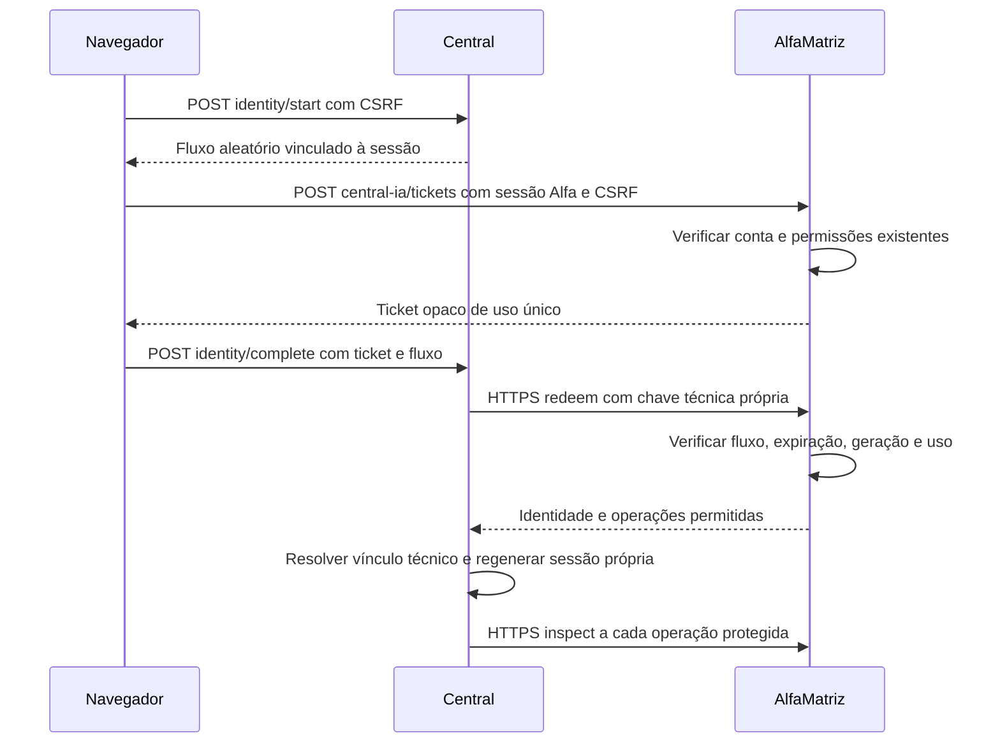

# AlfaMatriz / Central — identidade validada em desenvolvimento

Data: 10/10/2026. Nenhuma ativação, migração, vinculação ou alteração de dados reais.

## Relatório histórico e validação posterior

Os números deste documento representam o primeiro ensaio na base `7c40982`.
A cópia foi posteriormente sincronizada com a main `1e2bbb97`, recebeu vendor
próprio conforme lock e a interface nativa. A nova validação está em
[interface-integration.md](interface-integration.md), que substitui os impedimentos
antigos de dependências/cópia incompleta. A falha 503 histórica continua sem causa
confirmada e mantém o impedimento de publicação. O fluxo com ticket no navegador
abaixo é histórico: o módulo nativo usa resgate exclusivamente entre servidores
e deixa a emissão de tickets ao navegador desabilitada por padrão.

## Implementação e fronteiras

O AlfaMatriz original em `/mnt/c/xampp/htdocs/AlfaTecnologia` continua intacto.
Foi usada uma cópia de seu código em `development/alfamatriz`, com as dependências
existentes somente para leitura. A Central candidata permanece em
`development/multiuser`; os serviços da Central atual não usam esses diretórios.
Não houve instalação, inferência, API paga ou deploy. Nenhuma autenticação de
Codex/Claude, APP_KEY existente, banco real ou arquivo `.env` foi lido ou copiado.

Os testes utilizam o `LoginRequest`, o guard de sessão, `ContaAtiva`, a troca
obrigatória de senha e `User::canPermissao` do AlfaMatriz. São mecanismos reais
do framework e do sistema, executados com contas e dados sintéticos. Não foram
consultadas as contas ou conversas reais de Felipe, Rossini e Alexandre.

O usuário não recebe um cadastro independente na Central. A sessão exige um
vínculo técnico previamente provisionado, identificado por UUID estável da
autoridade. O candidato não cria usuários ao receber tickets, não associa por
nome/email e não aceita um ID do navegador como autenticação. As três projeções
locais usadas nos testes foram criadas explicitamente como fixtures.

Ticket e fluxo têm 120 segundos de validade. O AlfaMatriz armazena apenas seus
hashes; a Central armazena o hash do fluxo na sessão. Não transitam em URLs.
O resgate exige chave técnica dedicada, audiência fixa e TLS validado, sem
redirecionamentos ou retries. A Central mantém seu próprio cookie, sessão e
APP_KEY; nenhuma sessão Alfa é usada como sessão Central.

Endpoints:
- Alfa, autenticação humana existente: `POST /central-ia/tickets`.
- Alfa, autenticação técnica dedicada: `POST /internal/central-ia/inspect`
  e `POST /internal/central-ia/redeem`.
- Central, fluxo protegido por CSRF e estado de sessão: `POST /identity/start`
  e `POST /identity/complete`.

O navegador envia somente ticket/fluxo. Campos como `user_id`, `subject`,
`owner_id` e `redirect_uri` são recusados no fluxo humano. A consulta técnica
por subject nunca é uma porta de login e exige a chave do servidor.

## Permissões e revogação

Foram acrescentados recursos ao modelo de permissões existente, sem concessões
automáticas ou criação de um sistema paralelo:

| Operação Central | Permissão AlfaMatriz |
| --- | --- |
| read | central_ia / ler |
| send | central_ia / ler + incluir |
| pair, integrations, sessions | central_ia / ler + editar |
| execute | central_ia / ler + central_ia_execucao / incluir |

Conta inativa, excluída ou com primeira troca de senha pendente não é elegível.
O papel Administrador não é enviado nem interpretado como autorização para
conteúdo privado. O seeder preserva as permissões administrativas antigas, mas
exclui os dois recursos novos de suas concessões automáticas. O teste anterior
de "admin em todos os recursos" foi ajustado para verificar as permissões antigas
e a ausência explícita de grants automáticos de IA.

Gerações de sessão são invalidadas em logout, mudança de senha/estado, exclusão,
restauração, mudança de perfil do usuário e alteração da grade de um perfil.
As mudanças de grade/vínculo e geração são transacionais. A geração é local ao
AlfaMatriz: não depende de WSL2 ou da disponibilidade da Central. Um fingerprint
de estado/operações também detecta alterações ao consultar a autoridade. Respostas
da autoridade são sempre verificadas; não há fallback para permissões em cache.
Mudanças feitas por SQL direto exigirão invalidação explícita no procedimento
administrativo, além da verificação de permissões atuais.

Sessões antigas da Central são recusadas quando a geração muda. Uma nova entrada
validada pode atualizar a geração de um vínculo ativo; não reativa uma revogação
local. O vínculo Telegram é preservado, mas não supera a autorização atual.

Flags padrão desabilitadas: `CENTRAL_IA_ENABLED` no Alfa e
`CENTRAL_IDENTITY_BRIDGE_ENABLED` na Central. A indisponibilidade do outro sistema
afeta o módulo e não introduz chamadas remotas no login ou nas telas administrativas
do AlfaMatriz. Dados compartilhados e execução de agentes continuam desabilitados.

## Evidências dos testes

| Verificação | Resultado |
| --- | --- |
| AlfaMatriz: nova autoridade + regressões Auth/Usuarios/Permissoes/Auditoria/Sessao/Seguranca/Desempenho | 198 testes / 670 asserções aprovados |
| Central: regressões e sessão SSO, SQLite em memória | 64 testes aprovados / 327 asserções; 6 do laboratório omitidos nessa execução |
| Central: mesma suíte, PostgreSQL 17 descartável | 64 testes aprovados / 327 asserções; 6 do laboratório omitidos nessa execução |
| Contrato real entre aplicações via HTTPS, sem mocks da autoridade | 6 testes / 70 asserções aprovados |
| Backup/restauração cifrada de fixtures PostgreSQL | 6 verificações aprovadas; 24 tabelas, 42 registros, 15 sequências |
| Preservação do Alfa original | 586 arquivos comparados por SHA256, nenhum alterado; Git rastreado sem alterações |
| Patch futuro | git apply --check aprovado; patch não aplicado |

São **268 testes distintos aprovados**, além das seis verificações do backup.
As execuções SQLite/PostgreSQL repetem a mesma suíte e não contam como novos testes.

Cobertura do contrato real: login com senha de fixture pelo controlador original,
ticket emitido para o usuário autenticado, sessão Central derivada do resgate,
históricos separados entre três usuários, manipulação de IDs recusada, administrador
Alfa sem acesso cruzado, permissões atuais, conta inativa, chave técnica incorreta,
CA não confiável, endpoint inacessível, CSRF do Alfa e da Central. As duas aplicações
têm chaves independentes. Resposta de IA e Telegram reais não fazem parte deste ensaio.

O laboratório tem rede Docker interna exclusiva, sem portas publicadas, socket Docker,
volumes de agentes ou banco existente. As chaves técnicas, senha de fixture e certificado
são novos, ficam em diretório temporário 0700/arquivos 0600 e são removidos junto ao
laboratório. Os contêineres têm usuário não privilegiado, raiz somente para leitura
e capacidades removidas. O proxy TLS não registra acessos; nenhum ticket vai em URL.

Diagnóstico de falhas da autoridade registra apenas categoria, status HTTP e código
numérico de transporte. Não registra corpo, URL, headers, tokens, cookies ou exceção
anterior. Canários de senha, ticket, fluxo e chave são testados contra storage,
auditoria e logs das fixtures.

### Limitações registradas no primeiro ensaio (ver atualização acima)

- A suíte integral do AlfaMatriz não está certificada por este ensaio. A primeira
  tentativa encontrou arquivos/recursos ausentes da cópia e dependências de testes
  de implantação. A tentativa posterior parou no template `.env.producao.exemplo`,
  intencionalmente não copiado. O resultado certificado é o recorte de 198 testes
  indicado acima; não afirmar que os 1.057 da descoberta ampla passaram.
- Duas depreciações PHPUnit já existentes em doc-comments de
  `Seguranca/EnderecoDeSistemaTest.php` permanecem. Não são erros do contrato.
- O Alfa foi ensaiado com Laravel 12, PHP 8.4 e SQLite. Antes de ativação, testar
  também PHP/MariaDB equivalentes ao ambiente de destino, em desenvolvimento.
- Uma execução HTTPS simultânea à regressão ampla recebeu 503 transitório na
  consulta de autoridade. A causa específica não foi confirmada. A execução
  isolada passou com os mesmos timeouts: connect 2s / resposta 5s, sem retries
  nem autorização por fallback. Fazer ensaio de carga/latência antes da ativação.
- O backup ensaiado é da Central com dados sintéticos. Não foi feito backup,
  restauração ou migração dos bancos reais, nem ensaiada restauração MariaDB do Alfa.
- A proteção de aplicação recusa privilégio administrativo automático sobre
  conteúdo. Acesso root/DB e recuperação privilegiada de contas exigem governança
  adicional; não é uma garantia contra quem controla a infraestrutura/identidade.

## Backup e restauração comprovados

`run-backup-lab.py` cria um PostgreSQL descartável exclusivo, povoa somente fixtures
e executa `pg_dump` custom. O dump permanece em memória e é cifrado com autenticação
libsodium antes de gravar o arquivo 0600. Não há dump em claro em disco ou terminal,
nem token de bot/agente, APP_KEY ou chave técnica no backup.

O teste confere digest do dump após decifrar, recusa chave incorreta e adulteração,
restaura em banco vazio distinto usando `pg_restore --exit-on-error`, compara contagens
e digests de todas as linhas/colunas e sequências, valida FKs e reconfirma que o banco
de origem não mudou. São preservados mensagens, proprietários, IDs, vínculos fictícios,
cursor Telegram, entregas pendentes/ambíguas, identidades, sessões, runs, quotas e auditoria.
Backup, bancos e chaves são descartados ao terminar. O programa é um **harness de teste**,
limitado a dumps sintéticos pequenos; não executar contra produção.

Na ativação futura, usar os procedimentos de backup de cada sistema com artefatos
cifrados e chave fora do backup. O backup do Alfa deverá incluir sujeitos estáveis,
gerações, grants e tickets usados/expirados; o da Central deverá incluir os vínculos
e todo o histórico. Os dois snapshots precisam de janela coordenada e ensaio de
restauração sem Telegram/IA/rede externa. Não copiar autenticações de agentes; manter
seus volumes intactos. Após restauração, reconciliar revogações e forçar nova entrada
antes de reativar integrações. Não gerar novos subjects para reparar um snapshot perdido.

## Arquivos preparados

Inventário completo: `development/identity-files.json`. Patch Alfa aplicável em
futura revisão: `development/alfamatriz-identity.patch` (não aplicado).

Alfa, arquivos novos do módulo:
- `app/Http/Controllers/CentralIdentityController.php`
- `app/Http/Middleware/CentralTechnicalCaller.php`
- `app/Services/CentralIdentitySnapshot.php`
- `app/Services/CentralIdentityEpochs.php`
- `config/central_ia.php`
- `database/migrations/2026_10_12_000001_create_central_identity_bridge.php`
- `routes/central-ia.php`
- `tests/Feature/CentralIdentityTest.php`

Alfa, alterações apenas na cópia:
- `app/Http/Controllers/PerfilController.php`
- `app/Http/Controllers/UsuarioController.php`
- `app/Providers/AppServiceProvider.php`
- `bootstrap/app.php`
- `database/seeders/PerfilPermissaoSeeder.php`
- `tests/Feature/Permissoes/MigracaoEditarTest.php`
- `tests/TestCase.php` — guarda de banco/HTTP e Vite exclusivamente do laboratório;
  excluído do patch que será revisado para o repositório original.

Central, arquivos novos/alterados nesta etapa em `development/multiuser`:
- `app/Contracts/IdentityGateway.php`
- `app/Http/Controllers/IdentitySessionController.php`
- `app/Services/Identity/AlfaIdentityAuthority.php`
- `app/Providers/AppServiceProvider.php`
- `bootstrap/app.php`, `config/central.php`, `routes/web.php`
- `tests/Feature/IdentitySessionTest.php`
- `tests/Feature/IdentityContractLabTest.php`

Infraestrutura de teste: `compose.alfamatriz-tests.yaml`, `compose.identity-lab.yaml`,
`compose.backup-lab.yaml`, os dois programas `run-*-lab.py`, `lab/*.php`,
`lab/nginx.conf`, `alfamatriz/phpunit.identity.xml` e os manifests em `development`.
Certificados, senhas, chaves e dumps não fazem parte desses arquivos.

## Próxima ativação — ainda depende de aprovação

1. Revisar os patches e completar testes com ambiente PHP/MariaDB de desenvolvimento
   equivalente ao destino, incluindo a suíte original com seus artefatos não sensíveis
   e o ensaio de carga. Manter produção, histórico e pareamento atuais intactos.
2. Preparar módulo Blade no AlfaMatriz: navegação protegida pela permissão existente,
   fluxo de entrada/saída e consulta à Central com estados de indisponibilidade.
   Definir o transporte autenticado entre Alfa hospedado e WSL2; não publicar a Central
   ou abrir acesso a projetos. Não colocar ticket em query string nem criar iframe
   com autorização ampla. Validar cookies distintos, TLS e proxy explicitamente confiável.
3. Preparar backup coordenado de ambos os sistemas e ensaiar restauração em ambientes
   descartáveis, com chaves protegidas separadamente. Confirmar o UUID real de Felipe
   na autoridade e o ID Central existente por operação administrativa autenticada,
   nunca por dado do navegador ou coincidência de email.
4. Somente com aprovação específica: aplicar migrações aditivas, preencher proprietários
   e associar a identidade atual de Felipe, conferindo IDs/contagens/cursor/vínculo antes
   e depois. Preservar o pareamento; desabilitar agentes durante toda a janela.
5. Validar acesso individual de ponta a ponta antes de incluir outros usuários.
   Provisionar cada identidade e grant explicitamente. Executores por usuário/provedor
   e adaptador Codex CLI continuarão em etapa separada, sem inferência nesta implantação.

## Rollback

Desativar os flags do módulo e parar somente consumidores/produtores da Central,
preservando os serviços administrativos do Alfa. Manter tabelas aditivas e identidades;
as novas migrações recusam remoção destrutiva. Restaurar código compatível com os
controles de propriedade e seeder sem grants automáticos de IA.

Antes de ingresso de um segundo usuário, o funcionamento mono-usuário anterior
pode ser preservado. Depois disso, nunca reexpor código antigo que ignore propriedade.
Preferir correção de código com esquema preservado; se restauração de banco for
necessária, arquivar cifrado o estado posterior, restaurar os snapshots verificados,
reconciliar mensagens/revogações e bloquear replay de entregas ambíguas. Mensagens
já recebidas no Telegram não são desfeitas nem reenviadas automaticamente.
