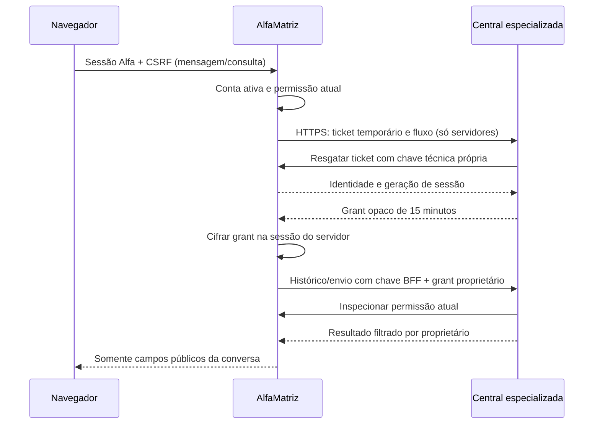

> **Histórico.** Este documento descreve a primeira versão (aplicação separada).
> Em 10/10/2026 o dono decidiu outro caminho — ver [README.md](README.md).

# Interface nativa da Central de IA — desenvolvimento

Data: 10/10/2026. Base AlfaMatriz: main `1e2bbb97fc5f4398129b42eeeec20d170fac2add`.
Somente candidatos `development/alfamatriz` e `development/multiuser` foram alterados.
O Alfa original e a Central atual continuam separados. Nenhuma conta real foi
vinculada, nenhuma inferência ocorreu, nenhum pareamento Telegram foi alterado.

## Implementação

Menu Central de IA no grupo Desenvolvimento, condicionado aos recursos existentes
`central_ia/ler` e às flags. Envio exige também `central_ia/incluir`. Administrador
não recebe esses recursos automaticamente nem acesso ao histórico de outro usuário.
A tela usa o layout, navegação, login, sessões, CSRF, perfil e tokens visuais do Alfa.
Não foram criados cadastros, tarefas, agenda ou uma segunda autenticação humana.

A conversa privada oferece paginação de 50 mensagens, autoria de usuário/agente/
ferramenta/evento, canal, estado de entrega, atualização e retomada por cursor.
Conteúdo é renderizado como texto escapado, sem HTML vindo de mensagens.
A conversa padrão de cada proprietário é reutilizada; múltiplas conversas e
compartilhamento explícito permanecem etapas futuras, sem ACL implícita de admin.

O polling usa 5s em aba visível e 15s em aba oculta; falhas têm backoff até 30s.
Não há sobreposição de polling; recuperar páginas pendentes usa o cursor de ID.
No navegador não são persistidos histórico ou rascunho em localStorage/sessionStorage.
Rascunho/envio não confirmado ficam em memória com aviso ao sair da página: recarregar
ou fechar deliberadamente após esse aviso pode perder um rascunho ainda não aceito.
Mensagens já aceitas são persistentes e reaparecem após atualização/reconexão.
Um timeout conserva texto e UUID; repetir usa os mesmos dados. O servidor deduplica.
Não há retry automático de POST nem disparo de agentes a partir dessa interface.

As rotas de histórico/envio usam os limiters Laravel do usuário autenticado
(60 leituras/min e 20 envios/min). A ponte possui também teto técnico compartilhado
(180 requisições/min na Central, 120/min na autoridade Alfa por origem técnica).
Polling cresce com usuários/abas; o piloto de três usuários foi ensaiado, sem alegar
capacidade indefinida. Ajustes futuros exigem métricas e limites coerentes nas duas
pontas. Limites de inferência permanecem 1 simultânea/120s/20 por dia, mas nenhum
endpoint desta interface executa agentes nesta etapa.

A moldura nativa funciona mesmo com backend ou executores offline. Sem o backend,
o histórico não pode ser consultado e o envio fica pendente com opção de repetir;
as demais funções do Alfa não passam a depender da disponibilidade do WSL2.
Mensagens de Codex/Claude nos screenshots são registros sintéticos identificados
como simulação. Não representam inferência ou conexão dos provedores.

## Identidade e fronteiras

O ticket de 120s/uso único é emitido e resgatado apenas entre servidores neste fluxo.
O endpoint humano antigo fica desabilitado por padrão. O navegador nunca recebe
subject, ticket, grant ou chave técnica; IDs de proprietário enviados por ele são
recusados. IDs públicos de mensagens/client_id são apenas cursores/idempotência.
A identidade depende da sessão autenticada e da autoridade, nunca desses IDs.

Há duas chaves técnicas dedicadas, uma para autoridade e outra para o BFF, ambas
novas no laboratório; APP_KEY e sessões não são compartilhados. O grant é cifrado
na sessão Alfa e somente seu hash é persistido na nova tabela da Central.
O driver de sessão cookie é recusado para manter grants no servidor.
HTTPS tem CA validada, destino fixo, sem redirect, timeout de conexão 2s/resposta 8s.
Falhas devolvem mensagens sanitizadas, sem corpos, URLs, headers ou credenciais.
A Central valida autoridade/geração e propriedade em cada requisição; consultas
repetidas dentro da MESMA requisição usam um snapshot. A próxima requisição consulta
novamente, com limpeza do cache ao final. Console/filas não recebem esse cache.
Revogação ou conta inativa bloqueiam acesso e removem o histórico exibido no cliente.

Sem mounts de sessões Codex/Claude, projetos externos, home ou socket Docker nos
serviços. Sem conexão real com Telegram/provedores/bancos existentes. O envio usa
a ConversationService existente e o mesmo banco candidato, preparando a continuidade
dos canais. O histórico e pareamento reais só serão vinculados em etapa aprovada.

## Arquivos revisáveis

Inventário completo: `development/identity-files.json`.
No Alfa: controllers CentralIa/Identity; CentralBackend, IdentityTickets e snapshot;
middleware de conta; config/routes; Blade `central-ia/index`; JS `central-ia.js`;
registro Alpine; item de navegação; hooks de revogação e testes de segurança.
Na Central: AlfaBridgeController/Caller; IdentityRequestScope; Access; endpoints
internos; tabela aditiva central_bridge_sessions; paginação/client_id e testes.

O patch `development/alfamatriz-identity.patch` inclui identidade e interface,
contra a main acima. Não foi aplicado ao original. Seeds/routers/controles de
laboratório e TestCase adaptado ficam excluídos do patch. O template versionado
`.env.producao.exemplo` foi restaurado apenas após conferir placeholders; nenhuma
configuração real foi copiada ou carregada.

## Ambiente e testes

PHP 8.2.30 Debian 12 com extensões GD/JPEG/WebP/FreeType, intl, PDO e demais requisitos.
MariaDB 10.11.18, utf8mb4/utf8mb4_unicode_ci, upload 12M/POST16M e debug desabilitado.
Servidor visual limitado a 128MB, sessão file e cookie secure. A suíte integral
usa 512MB exclusivamente para fixtures de imagem. Vendor próprio conforme lock,
Composer sem scripts/plugins, npm sem scripts. Nenhum vendor original alterado.
O destino foi aproximado pelo provisionamento versionado; configurações reais de
produção não foram lidas. FPM/opcache, proxy/túnel, latência e infraestrutura do
destino precisam de ensaio representativo antes de ativação.

Resultados verificáveis: `development/reports/interface-validation.json`, JUnit,
`interface-browser.json`, `runtime-compatibility.json` e `backup-validation.json`.
Screenshots: `central-ia-desktop.png`, `central-ia-mobile.png` e versão clara.

| Verificação final | Resultado |
| --- | --- |
| Suíte integral AlfaMatriz/PHP8.2/SQLite | 1.403 aprovados, 8.508 asserções, 0 falhas/erros/omitidos |
| Central/SQLite | 72 aprovados, 396 asserções; 6 HTTPS omitidos apenas nesta suíte |
| Central/PostgreSQL17 | 72 aprovados, 396 asserções; mesmos 6 omitidos |
| Contrato HTTPS real entre aplicações | 6 aprovados, 70 asserções |
| Navegador/MariaDB10.11 | 9 verificações aprovadas, 3 contas fictícias |
| Carga curta | 30 respostas HTTP200, 6 simultâneas; p50 282ms, p95 493ms, máximo796ms |
| Backup/restauração cifrada | 6 verificações; 25 tabelas, 43 registros, 16 sequências |
| Original Alfa | 586 SHA256 intactos, Git rastreado sem mudanças |
| Central atual | SaúdeHTTP200; histórico e pareamento não alterados |

Os resultados SQLite/PostgreSQL repetem testes, não somar como testes distintos.
Duas depreciações antigas por doc-comments PHPUnit permanecem, sem falha funcional.
A primeira execução ampla teve lacunas do harness; três falhas ambientais restantes
foram corrigidas pela restauração do template seguro versionado e Git fictício.
A execução integral FINAL acima inclui todas essas correções e a nova interface.
A carga curta também foi executada durante outras suítes: p95 1.494ms, igualmente
30/30 HTTP200. Esses números não são SLA ou previsão para produção.

### HTTP 503 e impedimento de publicação

A causa específica do 503 observado no ensaio histórico NÃO foi confirmada.
Foram eliminadas lacunas do harness: dependências de outra base, recursos ausentes,
GD sem JPEG, locale, permissões de exec dos testes e metadados Git fictícios.
A interface evita amplificar inspeções de autoridade (uma por requisição).
O laboratório usa múltiplos workers porque Alfa chama Central e Central consulta
Alfa durante a mesma operação; um servidor CLI com um worker não representa FPM.
Isso é requisito observado da topologia, não prova da causa do 503 histórico.
Falha/transporte503 sanitizado e reconexão são testados. A carga curta sem 503
não substitui diagnóstico da ocorrência anterior nem soak test de staging.
**Publicação permanece bloqueada** até evidências de causa/correção e operação
estável em ambiente representativo, com métricas sanitizadas e correlação sem tokens.

## Ativação controlada e rollback (ainda não executados)

1. Revisar patch/inventário e confirmar versão main alvo, sem commit/deploy nesta etapa.
2. Ensaiar staging com PHP/FPM/MariaDB equivalentes, TLS privado e rota de rede Alfa–
   Central. Alfa hospedado deve continuar funcionando mesmo com WSL2 indisponível.
   Não publicar a Central/BFF na internet para contornar conectividade.
3. Investigar503 com status/categoria/latência, workers e correlação sem payloads,
   repetir carga e indisponibilidade controlada. Resolver impedimento antes de publicar.
4. Antes de qualquer dado existente: backup cifrado de Alfa e Central, armazenamento
   restrito e restauração descartável com integridade/contagens/seq/FKs comprovadas.
   O ensaio atual usa somente fixtures e não equivale a backup dos bancos reais.
5. Com aprovação específica: mudanças aditivas, flags desabilitadas, segredos técnicos
   próprios e acesso mínimo de rede. Confirmar identidade real de Felipe e vínculo
   explícito ao proprietário atual, preservando IDs/histórico/Telegram; sem copiar
   credenciais pessoais. Grants aos demais usuários só por aprovação e teste.
6. Habilitar piloto individual e monitorar negações/latência/dedup/autoria/canais.
   Execução IA e adaptador CLI são outra etapa, continuam desabilitados.

Rollback: desligar CENTRAL_IA_UI_ENABLED/CENTRAL_IA_ENABLED no Alfa e bridge da
Central; remover menu/rota ativa por flags, invalidar grants técnicos, preservar
tabelas aditivas e histórico. Reverter apenas código aprovado para a versão anterior,
sem down destrutivo nem exclusão de mensagens. Restaurar backup somente por decisão
explícita caso haja corrupção, com serviços exclusivos quiescentes e reconciliação
de mensagens novas. Sem rollover de sessões pessoais/credenciais de agentes.

Preview somente com fixtures: `python3 development/run-interface-lab.py --preview`;
porta8110 pelo VS Code, https://localhost:8110/central-ia, senha oculta escolhida
localmente. Ctrl+C encerra apenas o laboratório. Não usar contas reais.
