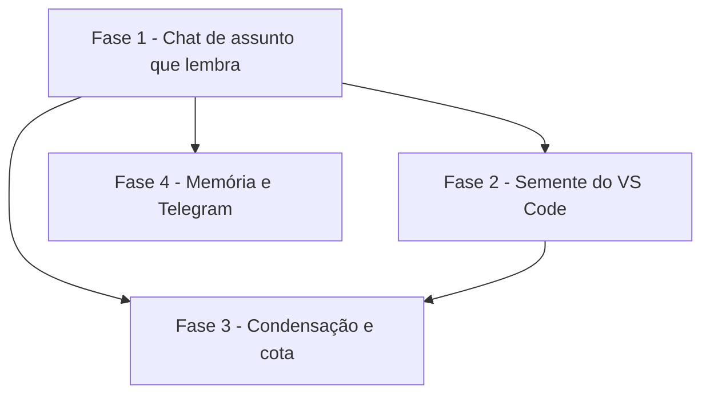

# Tarefas Central de IA - Chats Business

Escopo: chats contínuos por assunto na Central de IA, com memória própria lida por qualquer agente da
conta, semeados das conversas do VS Code (primeira leva de quatro chats), com histórico dentro de um
orçamento de contexto e memória visível e corrigível. Ref: `docs/specs/chats-business/{spec,plan}.md`.

**Legenda de status:**
- `[ ]` Pendente
- `[~]` Em andamento
- `[x]` Concluido
- `[!]` Bloqueado

**Legenda de criticidade:**
- `[C]` Critico - Impacto financeiro direto ou bloqueante
- `[A]` Alto - Funcionalidade essencial
- `[M]` Medio - Necessario mas sem urgencia imediata

---

## FASE 1 - Chat de assunto que lembra (P1)

### 1.1 Migração e modelo `[A]`

Ref: data-model.md; FR-002, FR-003

- [x] 1.1.1 Migração `2026_10_14_090000_chats_de_assunto`: `tipo` (padrão `tarefa`), `grupo_id` e índice `(user_id, tipo, status)` em `central_ia_tarefas`; `assunto_atual_id` em `central_ia_telegram_vinculos`; com `down()`
- [x] 1.1.2 Conferir a migração em SQLite (suíte) e em MariaDB (`alfamatriz-dev`, com backup das tabelas `central_ia_*` antes)
- [x] 1.1.3 `CentralIaTarefa`: constante `ASSUNTO`, `scopeAssuntos()`, `scopeTarefas()`, relação `grupo()` e `tipo`/`grupo_id` no fillable
- [x] 1.1.4 Chats Ativos, Projetos, contagem de tarefas e `contextoDoProjeto` passam a filtrar `tipo = 'tarefa'`
- [x] 1.1.5 Teste: um assunto não aparece em Chats Ativos nem na aba Tarefas do projeto

### 1.2 Contexto do assunto dentro do orçamento `[A]`

Ref: research D3; FR-004, FR-010, FR-013, SC-003

- [x] 1.2.1 `ContextoDoAssunto::paraPrompt`: memória + condensado + parte recente literal, estimativa de tokens (caracteres ÷ 3,5) e resumo `{tokens_estimados, modo, mensagens_fora}`
- [x] 1.2.2 `Preferencias`: `assunto_contexto_tokens` (padrão 60000, faixa 20000–150000) com validação
- [x] 1.2.3 `AgentesService::pedir` usa `ContextoDoAssunto` em `tipo = 'assunto'` e grava o resumo em `roteamento.contexto`
- [x] 1.2.4 `concluir`: assunto nunca vai para `concluida`; volta para `aberta` ou `aguardando_voce`
- [x] 1.2.5 Testes: histórico pequeno vai inteiro; o contexto nunca passa do orçamento; troca de agente recebe a mesma memória; `tarefa_concluida` é ignorado

### 1.3 Rotas de assunto `[A]`

Ref: contracts/assuntos.md §B; FR-002, FR-014

- [x] 1.3.1 `POST central-ia/assuntos` e `PUT central-ia/assuntos/{assunto}` (nome, grupo, projeto, arquivar e reabrir), com grupo e projeto validados na conta
- [x] 1.3.2 `assuntos[]` no `painel` (`CockpitService`), sem os arquivados
- [x] 1.3.3 Testes de isolamento: outra conta recebe 404 em todas as rotas; admin não vê; o painel dela não lista assunto alheio

### 1.4 Aba Business na tela `[A]`

Ref: research D9; FR-001, FR-018, SC-005

- [x] 1.4.1 Aba de topo "Business" com lista agrupada e recolhível (mesmos grupos de Projetos), pulso e novidade
- [x] 1.4.2 "+ Novo assunto" (nome, grupo, projeto opcional) e abertura do painel de conversa com o assunto
- [x] 1.4.3 Linha de sistema com o contexto enviado (inteiro ou condensado, tamanho) e o custo
- [x] 1.4.4 `npm run build`, screenshot Playwright nos temas claro e escuro, sem erro de JS
- [x] 1.4.5 Teste do redesign: sem hex solto, sem `<table>` cru, sem SVG fora do `x-nav-icon`

### 1.5 Assunto sem projeto trabalha nas pastas de ~/projetos `[A]`

Ref: emergiu na execução da Fase 1 (13/10/2026). Na Geral, mensagem que não é pergunta só era anotada e implementar era recusado; um "Comercial VixCard" precisa mexer em arquivos.

- [x] 1.5.1 No assunto, toda mensagem vai a uma IA (sem a regra de anotação da Geral)
- [x] 1.5.2 Assunto sem projeto pode implementar, na raiz dos projetos (`na_pasta`, sem worktree), com as mesmas confirmações
- [x] 1.5.3 Fila: o filtro `['']` de projetos ocupados barrava implementar sem projeto; corrigido
- [x] 1.5.4 Teste: assunto sem projeto aciona IA e implementa na raiz; a Geral continua sem implementar

---

## FASE 2 - Semente a partir do VS Code (P2)

### 2.1 Sessões com título, raiz e cópia do Mac no runner `[A]`

Ref: research D7, D8; contracts §A; FR-007

- [ ] 2.1.1 `uso-local.mjs`: `titulo` (customTitle, depois aiTitle, depois o primeiro pedido em 80 caracteres)
- [ ] 2.1.2 `uso-local.mjs`: sessão da raiz `~/projetos` com projeto `''`; arquivos de `~/.local/share/alfa/central-ia-importadas/` com origem `mac_copia`
- [ ] 2.1.3 `CentralIaRunnerController::sessoes`: aceita `titulo`, `origem` e projeto `''`, com limite de 120
- [ ] 2.1.4 Teste Node: títulos, raiz e cópia (fixtures `.jsonl` pequenas)
- [ ] 2.1.5 Teste PHP: a batida aceita sessão da raiz e continua recusando projeto alheio

### 2.2 Extrato e partes `[A]`

Ref: research D6; FR-016

- [ ] 2.2.1 `deploy/central-ia/extrato.mjs`: `extrair(arquivo, {desde, aPartirDe: hoje-7d})` (FR-022: só a última semana) com turnos pedido e resposta final cortados em 4 mil caracteres, sem ferramenta, sidechain nem meta
- [ ] 2.2.2 `partes(turnos, 100000)` e `estimar()`
- [ ] 2.2.3 `tools/central-ia/test-extrato.mjs`: fixture com tool output, sidechain e meta; limites de corte e partes

### 2.3 Execução `semear` `[A]`

Ref: research D6; contracts §A; FR-008, FR-015, FR-016

- [ ] 2.3.1 `AgentesService::semear` e `POST central-ia/assuntos/semear` (1 a 5 sessões, escopadas em `sessoes($user)`); `finalidade = semear` no payload de `proxima`
- [ ] 2.3.2 Runner: localiza o arquivo pelo id entre as próprias sessões (recusa id desconhecido) e estima; acima do teto, conclui com `estimativa_caracteres`
- [ ] 2.3.3 Runner: uma passada por parte com o modelo `leve` e o prompt "mapa do trabalho primeiro (pastas, arquivos, sistemas, etapa de cada frente); só o que está no texto", mais uma passada final que junta; devolve bloco e `semente[]`
- [ ] 2.3.4 Runner: apaga a cópia `mac_copia` depois do sucesso
- [ ] 2.3.5 Servidor: grava a memória de partida (via `ProtecaoDeSegredos`) e `sementes[]`; teto vira "aguardando você" com opções Sim e Não
- [ ] 2.3.6 `Preferencias`: `semente_teto_caracteres` (padrão 1.500.000)
- [ ] 2.3.7 Testes: sessão de outra conta é recusada; teto para antes de ler; segredo é mascarado; o runner não aceita caminho vindo do servidor

### 2.4 Modal "Trazer do VS Code" e primeira leva `[A]`

Ref: quickstart Cenário 1; FR-021

- [ ] 2.4.1 Modal com sessões (título, agente, origem, pasta, data), multiseleção, nome e grupo sugeridos, marca "já semeada"
- [ ] 2.4.2 Comando para o dono rodar no Mac (quickstart) e conferir a chegada das duas cópias
- [ ] 2.4.3 Semear os quatro chats: Proposta Comercial VixCard, Gestor.SG (duas sessões), Proposta comercial Grupo Soluções e Relatório avanço de obra
- [ ] 2.4.4 Conferir por amostra que a memória de cada um só tem decisões presentes na conversa original (SC-002)

### 2.5 Atualizar do VS Code `[M]`

Ref: FR-009

- [ ] 2.5.1 `POST central-ia/assuntos/{assunto}/atualizar-semente`: lê só a partir de `lido_ate`; 422 para origem `mac_copia`
- [ ] 2.5.2 Botão no chat e teste de leitura incremental

---

## FASE 3 - Condensação e cota (P3)

### 3.1 Condensar depois do pedido `[A]`

Ref: research D4; FR-011

- [ ] 3.1.1 Depois de criar o pedido, enfileirar `finalidade = condensar` na mesma tarefa quando o histórico não condensado passar do orçamento
- [ ] 3.1.2 `concluir` de `condensar` grava `dossie.condensado` (até 24 mil caracteres) e uma linha de sistema com mensagens e custo
- [ ] 3.1.3 Testes: o condensado entra no contexto seguinte; decisões e pendências vão inteiras; não enfileira duas condensações

### 3.2 Contexto reduzido pela cota `[A]`

Ref: research D5; FR-012

- [ ] 3.2.1 Ler `limites_claude.janelas` ("Sessão…") e `cota_codex.primaria`; com 80% ou mais para o agente escolhido, modo reduzido (memória + 10 últimas mensagens) e aviso
- [ ] 3.2.2 Testes: Claude a 85% reduz; Codex a 50% não reduz; Copilot segue a regra normal

### 3.3 Ajustes `[M]`

- [ ] 3.3.1 Campos de orçamento de contexto e teto de importação em Ajustes
- [ ] 3.3.2 Teste da validação das faixas

---

## FASE 4 - Memória visível e Telegram (P4)

### 4.1 Memória corrigível `[A]`

Ref: data-model.md; FR-005, FR-006

- [ ] 4.1.1 `Dossie`: `mapa` e `jeito_de_fazer` no bloco e em `aplicarConclusao`, com dedupe normalizado e no máximo 40 itens
- [ ] 4.1.2 `Dossie::aplicarCorrecao` e `GET/PUT central-ia/assuntos/{assunto}/memoria`
- [ ] 4.1.3 Sub-aba Memória com editar e apagar e o histórico das correções
- [ ] 4.1.4 Testes: item apagado não vai no pedido seguinte; correção prevalece sobre item de agente; outra conta recebe 404

### 4.2 `/assunto` no Telegram `[M]`

Ref: research D10; FR-019

- [ ] 4.2.1 `/assunto` lista; `/assunto <nome|número>` aponta; `/geral` limpa
- [ ] 4.2.2 Mensagem com `assunto_atual_id` vira pedido na tarefa do assunto
- [ ] 4.2.3 Testes do canal (Http fake) e reinício do container do bot

### 4.3 Fechamento `[A]`

- [ ] 4.3.1 Suíte `CentralIa|Redesign` e testes Node verdes
- [ ] 4.3.2 Runner reiniciado em ociosidade e observado (Princípio V)
- [ ] 4.3.3 Quickstart Cenários 3 a 10 conferidos na tela
- [ ] 4.3.4 `docs/central-ia/README.md` com a seção Chats Business

---

## Matriz de Dependencias

## Resumo Quantitativo

| Fase | Tarefas | Subtarefas | Criticidade |
|------|---------|------------|-------------|
| 1 - Chat de assunto que lembra | 5 | 22 | A |
| 2 - Semente do VS Code | 5 | 21 | A/M |
| 3 - Condensação e cota | 3 | 7 | A/M |
| 4 - Memória e Telegram | 3 | 11 | A/M |
| **Total** | **16** | **61** | - |

## Escopo Coberto

| Item | Descricao | Fase |
|------|-----------|------|
| FR-001–FR-004, FR-010, FR-013, FR-014, FR-017, FR-018 | Assunto, aba Business, contexto no orçamento, isolamento | 1 |
| FR-007–FR-009, FR-015, FR-016, FR-020, FR-021 | Semente, cópia do Mac, primeira leva | 2 |
| FR-011, FR-012 | Condensação e cota | 3 |
| FR-005, FR-006, FR-019 | Memória corrigível, Telegram | 4 |

## Escopo Excluido

| Item | Descricao | Motivo |
|------|-----------|--------|
| Runner leitor no Mac | Leitura permanente das conversas do Mac | Dono escolheu a cópia única em 13/10/2026 |
| Importar todas as conversas | Gestor.VixCard, AlfaHome, English etc. | Dono: "os demais posso iniciar lá do zero" |
| Grupos do VS Code | Ler os grupos do Mac | Não estão nos arquivos do WSL (research D7) |
| Produção | Subir os Chats Business para produção | Só com a Central 100% e autorização do dono |
