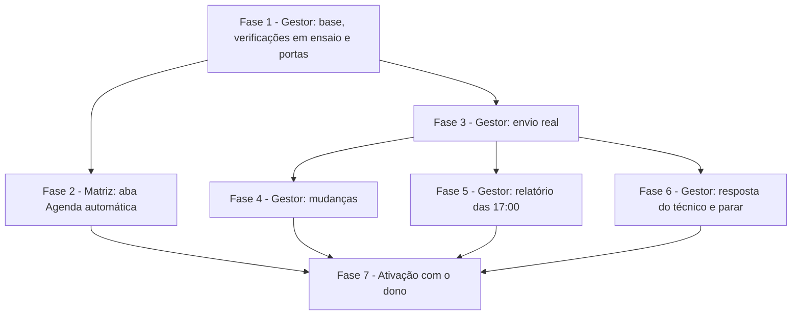

# Tarefas pedro-agenda-automatica - O Pedro comunica a agenda aos técnicos e aos gestores pelo WhatsApp

Escopo: quebra do `plan.md` (fases A a G) em tarefas. Tudo o que envia roda no Gestor (`~/projetos/gestor`); o
AlfaMatriz (este repositório) ganha só a aba de administração e supervisão. Nasce desligada, com modo ensaio; envio
real só com o modo `ligada` **e** `APP_ENV=production`, e só depois da autorização expressa do dono (SC-006).

Decisões do plano confirmadas pelo Felipe em 02/11/2026 ("Sim, as quatro e seguir para as tarefas"): só a conta
dona do Pedro administra (Decision 16); aviso aos gestores pelo WhatsApp, com o 4º modelo `agenda_alerta` (Decision
15); registro guardado por 365 dias (Decision 20); programação ou relatório perdidos saem na hora, mesmo à noite
(Decision 11).

Regras que valem para toda fase:

- Cada fase termina com os testes dela verdes, `pint` limpo e, no Gestor, a revisão independente (Copilot) até
  `APROVADO`, com o escopo em `~/projetos/gestor/.qa-diff-agenda-automatica.md` (constituição do Gestor, III).
  Commit e publicação são pedidos à parte, cada um com autorização pontual.
- Testes do Gestor: `docker exec gestor_php sh -c 'cd /var/www && php artisan test --testsuite=Integracao --filter=Agenda'`
  (banco `gestor_alfa_test`), Meta falsificada com `Http::fake`, relógio com `travel`. Testes do Matriz:
  `tests/Feature/Suporte/` com o Gestor falsificado e a suíte isolada
  (`tools/central-ia/run-tests.py --central-root /home/duque_de_caxias/projetos/central-agentes`).
- Nenhum teste chama a Meta de verdade nem usa número real. Telefone sai do Gestor só pelo final.
- O Gestor publica antes do Matriz: a aba chama portas que precisam existir.

**Legenda de status:**
- `[ ]` Pendente
- `[~]` Em andamento
- `[x]` Concluido
- `[!]` Bloqueado

**Legenda de criticidade:**
- `[C]` Critico - Impacto financeiro direto ou bloqueante
- `[A]` Alto - Funcionalidade essencial
- `[M]` Medio - Necessario mas sem urgencia imediata

---

## FASE 1 - Gestor: base, verificações em ensaio e portas (plano: Fase A)

Nenhuma chamada à Meta nesta fase. Com o modo `desligada`, publicar não muda nada para ninguém.

### 1.1 Tabelas e modelos `[A]`

Ref: `data-model.md`; FR-012, FR-024, FR-028-INFRA-SCHED, FR-029-INFRA-IDEMP; Decisions 2, 5, 20

- [x] 1.1.1 Migração de `agenda_destinatarios` (único `funcionario_id + papel`), com `down()`
- [x] 1.1.2 Migração de `agenda_avisos` (único `destinatario_id + dia_agenda + tipo + versao + modo`; índices `dia_agenda + tipo` e `situacao + proxima_tentativa_em`; `wamid` único), com `down()`
- [x] 1.1.3 Migrações de `agenda_verificacoes` (único `tipo + dia + modo`) e `agenda_observacoes` (único `destinatario_id + dia_agenda + modo`), com `down()`
- [x] 1.1.4 Modelos `AgendaDestinatario` (com `LogsActivity` dos campos da tabela), `AgendaAviso`, `AgendaVerificacao` e `AgendaObservacao`, com as relações do `data-model.md`
- [x] 1.1.5 Rodar as migrações, desfazer e rodar de novo só no `gestor_alfa_test`; conferir que nenhuma tabela existente mudou
- [x] 1.1.6 Testes: os índices únicos recusam a segunda linha de aviso, de verificação e de destinatário

### 1.2 Configuração `[A]`

Ref: `data-model.md` (Configuração); FR-025; Decisions 11, 13, 17

- [x] 1.2.1 `AgendaAutomatica\Configuracao`: lê e grava `app_settings.agenda_automatica`, com os padrões (`desligada`, 06:30, 16:30, 17:00, 20:00) quando a chave não existe
- [x] 1.2.2 `envioReal()` = modo `ligada` **e** `APP_ENV=production`; em qualquer outro ambiente, `ligada` se comporta como ensaio
- [x] 1.2.3 Validação dos horários (`manha` < `programacao` ≤ `relatorio` < `silencio_inicio`) e o silêncio de `silencio_inicio` até `manha`
- [x] 1.2.4 Chave `agenda_automatica` em `config/whatsapp.php`: `portal_url` (`AGENDA_PORTAL_URL`), `nunca_enviar` (`AGENDA_NUNCA_ENVIAR`), `estavel_minutos` 2, `margem_janela_minutos` 5, `tentativas_minutos` `5,15`; nenhum número no código
- [x] 1.2.5 Testes: padrões sem a chave; `ligada` em `local` não é envio real; horários fora de ordem recusados; dentro e fora do silêncio, inclusive a virada da meia-noite

### 1.3 Destinatários, número e pendências `[C]`

Ref: FR-001 a FR-004, FR-006; Decisions 17, 19; spec, Edge Cases

- [x] 1.3.1 `AgendaAutomatica\Destinatarios`: número lido de `funcionarios.celular` a cada uso (só dígitos, 55 na frente com 10 ou 11 dígitos, validado por `TelefoneHelper::chave`); nunca grava em `funcionarios`
- [x] 1.3.2 Pendência calculada na ordem do `data-model.md`: `inativo` → `parou` → `sem_consentimento` → `sem_numero` → `numero_compartilhado` → `nunca_enviar`
- [x] 1.3.3 `numero_compartilhado` quando outro funcionário ativo tem a mesma chave; o "parar" fica preso ao destinatário, não ao número
- [x] 1.3.4 `nunca_enviar` pelas chaves de `AGENDA_NUNCA_ENVIAR` (é onde o 3269 entra), sem o número no código nem nos testes
- [x] 1.3.5 `tecnicoAtivoPelaChave()` para a Fase 6: destinatário técnico ativo cujo celular tem a chave dada
- [x] 1.3.6 Testes com números fictícios: cada pendência, celular trocado no cadastro vale no envio seguinte, o mesmo funcionário com as linhas de técnico e de gestor

### 1.4 Programação do dia e versão `[A]`

Ref: FR-007 a FR-011; Decisions 3, 18; `data-model.md` (Compromisso)

- [x] 1.4.1 `AgendaAutomatica\Programacao`: visitas `agendado` do dia em que o técnico é responsável ou adicional (pivô `atendimento_visita_tecnicos`, com o horário individual do adicional quando houver)
- [x] 1.4.2 Compromisso `{atendimento, cliente, inicio, fim, visitas}` com `numero_atendimento` e `nome_tomador`; ordenado por início e nº
- [x] 1.4.3 Forma canônica sem os ids das visitas e versão sha256 dela, para que o `definirVisitas` (que apaga e recria) não mude a versão
- [x] 1.4.4 `em_atendimento`, `finalizado` e `cancelado` ficam fora; observação, valor, telefone e outro técnico nunca entram (FR-010)
- [x] 1.4.5 Testes: responsável e adicional; adicional com horário próprio; reagendamento pelo `definirVisitas` sem mudar o horário mantém a versão; sábado com visita entra; dia sem visita devolve lista vazia

### 1.5 Textos das mensagens `[A]`

Ref: `contracts/mensagens.md`; FR-010, FR-011, FR-022; Decision 7

- [x] 1.5.1 `AgendaAutomatica\Mensagens`: textos livres da programação, da mudança, do relatório, do alerta e da resposta fixa, como em `contracts/mensagens.md`
- [x] 1.5.2 Variáveis dos quatro modelos sem quebra de linha (itens separados por " • "), e o texto do técnico no alerta com as quebras viradas em espaço e cortado em 300
- [x] 1.5.3 Partes "(1/2)", "(2/2)" quando o corpo preenchido passa de 1024, cada parte completa
- [x] 1.5.4 Link do portal vindo de `portal_url`, sem token nem credencial (FR-011)
- [x] 1.5.5 Testes: os exemplos de `contracts/mensagens.md` saem iguais; nenhuma variável com `\n`; partição acima de 1024; nada de valor, observação ou telefone (SC-005)

### 1.6 Ciclo de minuto, verificações do dia e ensaio `[A]`

Ref: FR-007, FR-008, FR-025, FR-028-INFRA-SCHED, FR-029-INFRA-IDEMP, FR-030-INFRA-LOCK; Decisions 4, 5, 11, 13; quickstart, cenários 1 (em ensaio), 4 e 7

- [x] 1.6.1 Comando `whatsapp:agenda-automatica` e agendamento `everyMinute()->withoutOverlapping()->onOneServer()` em `routes/console.php`, sem job de fila
- [x] 1.6.2 `AgendaAutomatica\Ciclo`: roda a verificação que já passou da hora e não está concluída em `agenda_verificacoes`; a perdida roda ao voltar, no mesmo dia, inclusive depois das 20:00 (Decision 11, confirmada), e nunca duas vezes
- [x] 1.6.3 Modo `desligada`: só registra a linha da verificação com modo `desligada` (prova de que o agendador do host roda), sem aviso nenhum
- [x] 1.6.4 Verificação das 16:30 em ensaio: um aviso `programacao` com situação `ensaio` e o texto exato por técnico com visita; `sem_envio` para quem não tem visita (FR-008); `pendente` com o motivo para quem tem pendência
- [x] 1.6.5 Linha do aviso criada antes de qualquer envio, com a chave única; serialização por destinatário com `lockForUpdate` dentro de transação
- [~] 1.6.6 "Prévia agora" (programação ou relatório de hoje ou amanhã) sempre em ensaio, em qualquer modo, sem mexer na versão comunicada real
  - Feita a da programação. A do relatório depende do relatório: a porta 7 responde 422 `tipo_indisponivel` até a 5.2.5.
- [x] 1.6.7 Testes: verificação perdida das 16:20 às 18:40 roda uma vez às 18:41; perdida às 21:00 sai na hora; dois ciclos simultâneos geram uma linha só; desligada não cria aviso; ensaio não chama a Meta

### 1.7 Portas da integração Matriz → Gestor `[A]`

Ref: `contracts/integracao-agenda.md` (portas 1 a 7); FR-005, FR-024, FR-025, FR-028; Decision 16

- [x] 1.7.1 Rotas `api/integracao/matriz/agenda/*` com `AutenticaIntegracaoMatriz` e `throttle:120,1`; controller novo `Api/IntegracaoMatrizAgendaController`
- [x] 1.7.2 FormRequests `IntegracaoMatriz/Agenda*` para destinatários, configuração, avisos e prévia; `autor` obrigatório nas portas de escrita
- [x] 1.7.3 `estado` e `funcionarios`: só funcionários ativos e não apagados; telefone só pelo final; `modelos` pela lista de aprovados que a tela do WhatsApp já pôs no cache, sem chamar a Meta
  - QA da Fase 1 (02/11): a 1ª versão chamava `templatesAprovados` quando o cache vencia. Agora só lê o cache; sem ele, cada modelo sai com `conferido: false` e `aprovado: false`.
- [x] 1.7.4 `destinatarios` (incluir é idempotente; não há exclusão, só desativar) e `configuracao`, cada mudança com `activity()` do autor, o antes e o depois
- [x] 1.7.5 `avisos` (50 por página, filtros por dia, tipo, situação e modo) e `previa` (só hoje ou amanhã)
  - QA da Fase 1 (02/11): a prévia grava avisos, então o `activity()` dela leva também o antes e o depois — os avisos de ensaio do dia (id, destinatário, versão, situação, pendência), sem número nem texto.
- [x] 1.7.6 Testes das recusas: 401 sem o segredo, 404 de funcionário ou destinatário inexistente, 422 de horários e de dia inválidos
- [x] 1.7.7 Teste de contrato que chama as portas reais e confere chaves, tipos e enums contra `contracts/integracao-agenda.md` (quickstart, cenário 9, passo 1)

### 1.8 Fechamento da Fase 1 `[A]`

Ref: plan, Constitution Check (Gestor III e V); Decision 4

- [x] 1.8.1 `pint` nos arquivos da fase e a suíte `Integracao` do WhatsApp sem regressão (`WhatsappPedroTest` incluído)
- [x] 1.8.2 Seção 8 em `docs/specs/whatsapp-pedro/contracts/integracao-matriz.md` do Gestor, apontando para o contrato desta feature
- [x] 1.8.3 `.qa-diff-agenda-automatica.md` com o escopo exato e QA independente (Copilot) até `APROVADO`
  - Rodada 1 (02/11) REPROVADO: o `estado` chamava a Meta quando o cache vencia, e a prévia não tinha antes/depois no `activity()`. Rodada 2 (02/11) APROVADO.
- [x] 1.8.4 Pedir autorização para o commit e a publicação, só com os arquivos desta fase (as alterações de outras sessões no Gestor ficam de fora)
  - Autorizado em 03/11. Commit `52d1ce51` no Gestor, só com os arquivos da fase, depois de rodar a suíte num worktree limpo (`HEAD` + só a fase). Publicado pelo `gestor-publicar-main.sh` em 03/11, com as 4 migrações; o ponto de volta é o `2f506400`.
  - A 1ª tentativa parou no `git pull` da produção (`HEAD.lock` existia): os arquivos ficaram no disco, mas o HEAD e o banco continuaram no estado anterior, e o agendador deu "tabela inexistente" às 07:16 e 07:17. Quando a trava sumiu, a 2ª tentativa passou.
  - Notas da implementação (02/11/2026), para o QA e as fases seguintes: nos modos ensaio e real, o ciclo desta fase roda só a
    verificação da programação (a da manhã é a 4.3, a do relatório a 5.x); com `desligada`, as três registram que rodaram.
    `ligada` em produção antes da Fase 3 não manda nada: a verificação fica em aberto, com o erro dizendo isso
    (`Ciclo::SEM_ENVIO_REAL`). Decisões de borda registradas em `contracts/integracao-agenda.md` ("Decidido na Fase 1").
- [x] 1.8.5 Depois da publicação: conferir pela ponte, só leitura, que a linha da verificação em modo `desligada` aparece em produção; se não aparecer, o `schedule:run` do host não roda e a feature para aqui
  - Conferido em 03/11, às 07:18: a verificação #1 (`manha`, `desligada`) foi iniciada e concluída às 07:18:05, sem erro. A configuração continua sem linha em `app_settings` (vale `desligada`), e não há nenhum destinatário nem aviso. O agendador do host roda.

---

## FASE 2 - Matriz: aba Suporte › Agenda automática (plano: Fase B)

### 2.1 Cliente das portas `[A]`

Ref: `contracts/integracao-agenda.md` (Respostas do Matriz aos erros); plan, Source Code (Matriz)

- [x] 2.1.1 `App\Services\Suporte\AgendaAutomatica` com `services.suporte_gestor.url` e `.token`, timeout e as sete portas
- [x] 2.1.2 Tradução do `motivo` do Gestor, no padrão do `CanalWhatsApp::motivoDoGestor`; Gestor fora do ar ou 404 vira "O Gestor não respondeu; a configuração continua a que estava lá"
  - 404 **com** `motivo` (`funcionario_inexistente`, `destinatario_inexistente`) é recusa do contrato e tem frase própria; só o 404 sem `motivo` (porta que não existe) e o 5xx viram "não respondeu". 429 do `throttle` diz para tentar de novo; 422 no formato do Laravel mostra o primeiro erro que o Gestor deu.
- [x] 2.1.3 Conferência das chaves da resposta; o que faltar aparece como "sem dado", sem estimar
  - Cada objeto fica só com as chaves do contrato (chave a mais, como um número inteiro por engano, não passa do cliente), e as que faltarem vão em `faltando`: a tela distingue "sem dado" de um null que quer dizer "sem número" ou "sem pendência".
- [x] 2.1.4 Testes com o Gestor falsificado: respostas certas, 401, 404, 422, fora do ar e resposta sem as chaves esperadas

### 2.2 Rotas e autorização `[C]`

Ref: FR-005; Decision 16 (confirmada: só a conta dona administra)

- [x] 2.2.1 Rotas `suporte/agenda-automatica[/...]` (nomes `suporte.agenda-automatica.*`): ver com `permissao:suporte,ler`
  - A tela é `suporte.agenda-automatica`, sem sufixo, como `suporte.pedro` e `suporte.base`; as escritas são `.incluir`, `.mudar`, `.configurar` e `.previa`, com `permissao:suporte,editar` (o mesmo par da lista da casa) além da conta dona.
- [x] 2.2.2 Mudar destinatário, consentimento, horários e modo, e rodar a prévia: só a conta dona do Pedro (`services.suporte_pedro.conta`), pela mesma regra do `SuporteConhecimentoController::dono`
- [x] 2.2.3 Toda chamada de escrita leva como `autor` o e-mail de quem mudou
- [x] 2.2.4 Testes: a conta dona muda; outra conta com `suporte,ler` vê e recebe 403 ao mudar; sem `suporte,ler` não abre

### 2.3 Tela `[A]`

Ref: US4; FR-002, FR-005, FR-024, FR-025, FR-028; quickstart, cenário 8

- [x] 2.3.1 Aba "Agenda automática" em `resources/views/suporte/_abas.blade.php`, com o ícone `calendar` do `x-nav-icon`
- [x] 2.3.2 Topo: modo, envio real sim/não, os quatro modelos (conferido, aprovado, categoria, variáveis; sem a lista conferida, "não conferido") e as verificações de hoje e de ontem
- [x] 2.3.3 Destinatários com nome, papel, final do celular e pendência; incluir só escolhendo da lista de funcionários do Gestor, sem digitar número
- [x] 2.3.4 Consentimento ("a pessoa concordou em receber os avisos da agenda por este número"), ativar e desativar, horários e modo, com os botões escondidos para quem só vê
  - Passar a `ligada` pede, além do seletor, a caixa "as mensagens passam a sair de verdade" (validada no servidor), para o envio real não sair de um clique distraído (FR-025). Registrar consentimento passa pelo `x-confirmar`, com a frase do consentimento.
- [x] 2.3.5 "Prévia agora" e a lista de envios paginada, com filtros e o texto exato de cada aviso
- [x] 2.3.6 Blade + Alpine com os tokens do `tailwind.config.js` e do `design/README.md`; conferir no tema claro e no escuro
  - Conferido em 03/11 por captura (Playwright em Docker, CSS compilado da árvore, Gestor falso com dados fictícios), nos dois temas. Corrigidos na conferência: "3 tentativas" cortado pela metade, "1 pendências" e o e-mail do consentimento, que passou para o `title`.
- [x] 2.3.7 Testes de tela: carrega com o Gestor falso, mostra só o final do celular, mostra a mensagem do Gestor fora do ar sem erro 500

### 2.4 Fechamento da Fase 2 `[A]`

Ref: constituição do Matriz V e VII

- [x] 2.4.1 `tests/Feature/Suporte/AgendaAutomaticaTest.php` com o cenário 8 do quickstart inteiro
  - 8 testes. Com três defeitos plantados (sem a trava da conta dona no incluir, 404 sem motivo tratado como recusa, chave fora do contrato passando), cada um faz pelo menos um teste falhar.
- [x] 2.4.2 Suíte isolada inteira verde antes do commit
  - 03/11: 2.178 testes, nenhuma falha, 30 pulados. `pint --test` limpo nos três arquivos novos; o aviso no `routes/web.php` já existia no HEAD.
- [x] 2.4.3 Registro no #478 e aviso ao Rossini
- [x] 2.4.4 Pedir autorização para o commit e a tag; publicar só depois da Fase 1 no ar
  - Autorizado pelo Felipe em 03/11, com a Fase 1 no ar no Gestor desde as 07:18 (`52d1ce51`). Suíte isolada de novo antes do commit: 2.178 testes, nenhuma falha, 30 pulados. Tag `v2026.11.03.1`, sem migração, sem instalador e sem Gestor.

---

## FASE 3 - Gestor: envio real (plano: Fase C)

### 3.1 Envio que devolve o erro da Meta `[A]`

Ref: FR-024; Decision 8

- [ ] 3.1.1 Método novo no `WhatsAppCloudService` que devolve o wamid ou o código e o título do erro da Meta
- [ ] 3.1.2 `enviarTexto`, `enviarTemplate` e `postMessage` intactos para o menu, a cobrança e a integração
- [ ] 3.1.3 Testes com `Http::fake`: aceite, recusa 400 com `error.code`/`error.message` e falha de rede

### 3.2 Livre ou modelo, e as travas `[C]`

Ref: FR-004, FR-022, FR-027; Decisions 6, 7, 13, 17; SC-006

- [ ] 3.2.1 `AgendaAutomatica\Envio`: janela pela conversa mais recente do contato com a chave do celular (`WhatsappConversa::janelaAberta()`); fecha em menos de 5 min → modelo
- [ ] 3.2.2 Conferência do modelo antes de cada uso: nome, idioma `pt_BR`, número de variáveis e categoria UTILITY; ausente, diferente ou MARKETING vira `pendente/sem_modelo` e nada sai fora da janela
  - Vindo da Fase 1: o `estado` só lê a lista do cache da tela (`conferido`). Com a consulta à Meta liberada aqui, decidir se ele volta a buscar a lista quando o cache venceu.
- [ ] 3.2.3 Só quem criou a linha `preparada` chama a Meta; envio real só com `envioReal()`; `nunca_enviar` checado de novo na hora do envio
- [ ] 3.2.4 Grava canal, modelo, número, texto por parte, wamid e `enviado_em`; a mensagem não entra em `whatsapp_mensagens` nem cria conversa (FR-023)
- [ ] 3.2.5 Testes: janela aberta vai livre com quebra de linha; fechada vai modelo; modelo recategorizado não sai; `ligada` em `local` não chama a Meta; chave de `nunca_enviar` nunca recebe; reexecução não chama de novo

### 3.3 Tentativas `[A]`

Ref: FR-026; Decision 10; quickstart, cenário 5

- [ ] 3.3.1 Até 3 tentativas na mesma linha: a 2ª 5 min e a 3ª 15 min depois da anterior, pelo ciclo de minuto
- [ ] 3.3.2 No silêncio, a tentativa espera o fim dele; depois da 3ª, `falha` definitiva, sem reenvio no dia seguinte
- [ ] 3.3.3 Testes: recusa na chamada até a falha final; `failed` do webhook entra no mesmo caminho

### 3.4 Situação pelo webhook `[A]`

Ref: FR-024, FR-028; Decision 9

- [ ] 3.4.1 `processarStatus`: sem mensagem pelo wamid em `whatsapp_mensagens`, procura o aviso da agenda pelo mesmo wamid
- [ ] 3.4.2 Situação só avança (`aceita` → `entregue` → `lida`); `read` sem `delivered` vale como lida; `failed` grava o código e o título de `errors[0]`
- [ ] 3.4.3 Testes: cada status, fora de ordem, e que o caminho das mensagens de conversa não mudou

### 3.5 Retenção de 365 dias `[M]`

Ref: FR-024; Decision 20 (confirmada)

- [ ] 3.5.1 `AgendaAviso` com `Prunable`: com mais de 365 dias, `numero` e `texto` viram nulos e ficam tipo, dia, situação e contagens
- [ ] 3.5.2 Agendar o `model:prune` do `AgendaAviso` uma vez por dia em `routes/console.php` (hoje o Gestor não agenda nenhum `model:prune`)
- [ ] 3.5.3 Teste: aviso de 366 dias perde número e texto; de 364 dias fica igual

### 3.6 Fechamento da Fase 3 `[A]`

Ref: constituição do Gestor III e V

- [ ] 3.6.1 `pint` e a suíte `Integracao` do WhatsApp sem regressão (cobrança, menu e integração)
- [ ] 3.6.2 QA independente (Copilot) até `APROVADO`
- [ ] 3.6.3 Pedir autorização para o commit e a publicação, com o modo continuando `desligada`

---

## FASE 4 - Gestor: mudanças (plano: Fase D)

### 4.1 Comparação pareada `[A]`

Ref: FR-012, FR-013, FR-016; Decision 3

- [ ] 4.1.1 `AgendaAutomatica\Comparacao`: pareia o comunicado com o atual por atendimento (dois do mesmo atendimento no dia, pela ordem de início)
- [ ] 4.1.2 Classificação da tabela da Decision 3: nova visita, horário mudou, remarcada, cancelada, saiu da sua agenda; em atendimento ou finalizada não é mudança
- [ ] 4.1.3 Versão comunicada = a última linha do mesmo modo com `aceita`, `entregue`, `lida` ou `sem_envio` (no ensaio, também `ensaio`); falha não conta
  - Achado na Fase 1: a "Prévia agora" grava linhas `ensaio` de programação. Decidir se elas contam como comunicadas no modo ensaio (hoje contariam), para a prévia das 10:00 não virar "mudança" de ensaio antes das 16:30.
- [ ] 4.1.4 Testes: cada linha da tabela; troca de responsável (quem saiu e quem entrou); reagendamento pelo `definirVisitas` vira "horário mudou", e não "cancelada + nova"; mudança só em observação não gera nada

### 4.2 Estabilidade e silêncio `[A]`

Ref: FR-014, FR-015; Decisions 2, 11

- [ ] 4.2.1 `agenda_observacoes`: a mudança só sai com a mesma versão vista há 2 min ou mais
- [ ] 4.2.2 Mudança desfeita antes disso volta a ser igual à comunicada e não gera nada
- [ ] 4.2.3 Entre `silencio_inicio` e `manha` não sai aviso de mudança nem tentativa
- [ ] 4.2.4 Testes do cenário 2 do quickstart: nada às 17:10 e 17:11, aviso às 17:13; cancelamento às 22:00 só às 06:30

### 4.3 Verificação da manhã `[A]`

Ref: FR-014; US2

- [ ] 4.3.1 Às 06:30, só as mudanças da programação de hoje ainda não avisadas
- [ ] 4.3.2 Quem não recebeu programação na véspera e tem visita hoje recebe o aviso de nova visita
- [ ] 4.3.3 Testes: nada a avisar não manda mensagem; o que já foi avisado à noite não se repete

### 4.4 Fechamento da Fase 4 `[A]`

Ref: SC-003; constituição do Gestor III

- [ ] 4.4.1 Teste de ponta no ciclo: mudança gravada sai em até 10 min (SC-003)
- [ ] 4.4.2 `pint` e QA independente (Copilot) até `APROVADO`
- [ ] 4.4.3 Pedir autorização para o commit e a publicação

---

## FASE 5 - Gestor: relatório das 17:00 (plano: Fase E)

### 5.1 Contagens `[A]`

Ref: FR-017 a FR-019; Decision 18

- [ ] 5.1.1 `AgendaAutomatica\Relatorio`: visitas distintas e técnicos distintos (uma visita com dois técnicos conta 1 visita e 2 técnicos)
- [ ] 5.1.2 Conflito: o mesmo técnico em duas visitas com horários sobrepostos (o horário individual do adicional), nomeado com técnico, horários e nºs
- [ ] 5.1.3 Pendências: visita sem responsável, técnico com visita sem aviso aceito (com o motivo) e falha de leitura da agenda
- [ ] 5.1.4 Testes do cenário 3 do quickstart: os totais batem com a agenda (SC-004)

### 5.2 Formato e envio `[A]`

Ref: FR-017, FR-020; `contracts/mensagens.md`

- [ ] 5.2.1 Uma linha por técnico; técnicos com exatamente os mesmos compromissos ficam numa linha só
- [ ] 5.2.2 Dia sem visitas: uma linha só dizendo isso (FR-020)
- [ ] 5.2.3 Partes acima de 1024 e um relatório por gestor destinatário ativo, sem reenvio ao rodar de novo
- [ ] 5.2.4 Testes: agrupamento, dia vazio, partição e idempotência
- [ ] 5.2.5 Prévia do relatório na porta 7 (`tipo: relatorio`), que até aqui responde 422 `tipo_indisponivel`

### 5.3 Fechamento da Fase 5 `[A]`

Ref: constituição do Gestor III

- [ ] 5.3.1 `pint` e a suíte da agenda automática inteira
- [ ] 5.3.2 QA independente (Copilot) até `APROVADO`
- [ ] 5.3.3 Pedir autorização para o commit e a publicação

---

## FASE 6 - Gestor: resposta do técnico e "parar" (plano: Fase F)

**Precisa estar no ar antes de qualquer mensagem real a técnico.**

### 6.1 Desvio no MenuBot `[C]`

Ref: FR-021, FR-023; Decision 14; SC-007

- [ ] 6.1.1 `AgendaAutomatica\RespostaDoTecnico`, chamada no `MenuBot::processarNaConversa` logo depois do caso `suporte_no_matriz`, só em `aguardando_menu`
- [ ] 6.1.2 Vale para técnico destinatário ativo (pela chave do celular) que **não** está na lista da casa (`pedroInterno`); quem está na lista segue com o Pedro
- [ ] 6.1.3 Zera `com_pedro_desde` (o repasse leva `com_pedro = false` e o Matriz não chama a IA) e responde a frase fixa pelo `enviarSistema`, uma por sequência e no máximo uma a cada 2 min
- [ ] 6.1.4 Testes do cenário 6: nenhum menu; o `whatsapp:pedro-tempo-limite` não pega a conversa; mais duas mensagens em 1 min não geram resposta nova; o Felipe destinatário gestor segue com o Pedro
- [ ] 6.1.5 `WhatsappPedroTest` e os testes do menu sem regressão

### 6.2 Alerta aos gestores `[A]`

Ref: FR-021; Decision 15 (confirmada: WhatsApp, com o 4º modelo `agenda_alerta`)

- [ ] 6.2.1 Aviso `alerta` para cada gestor destinatário ativo, um por sequência (chave: a primeira mensagem da sequência)
- [ ] 6.2.2 Livre na janela, `agenda_alerta` fora dela, pelo mesmo `Envio` da Fase 3
- [ ] 6.2.3 Testes: nome do técnico e texto sem quebra de linha, cortado em 300; uma sequência gera um alerta por gestor

### 6.3 "Parar" `[C]`

Ref: FR-006; Decisions 14, 19

- [ ] 6.3.1 Texto normalizado (minúsculas, sem acento e sem pontuação) igual a `parar` grava `parou_em` e responde a confirmação
- [ ] 6.3.2 O alerta aos gestores diz que ele pediu para parar
- [ ] 6.3.3 A programação seguinte vira `pendente/parou`; voltar a receber só com o administrador registrando consentimento de novo
- [ ] 6.3.4 Testes: "Parar.", "PARAR" e "parar!" valem; "não vou parar agora" não vale; consentimento novo limpa `parou_em`

### 6.4 Fechamento da Fase 6 `[C]`

Ref: constituição do Gestor III e V

- [ ] 6.4.1 No Matriz, conferir por teste que a conversa repassada com `com_pedro = false` não vai à IA (o Pedro do Matriz não muda)
- [ ] 6.4.2 `pint` e QA independente (Copilot) até `APROVADO`
- [ ] 6.4.3 Pedir autorização para o commit e a publicação; só depois disso a Fase 7 pode ligar envio a técnico

---

## FASE 7 - Ativação com o dono (plano: Fase G)

Fora do código. Cada passo só com autorização expressa do Felipe.

### 7.1 Modelos da Meta `[C]`

Ref: `contracts/mensagens.md`; Decision 7; FR-022

- [ ] 7.1.1 O dono aprova os textos dos quatro modelos (`agenda_programacao`, `agenda_mudanca`, `agenda_relatorio`, `agenda_alerta`)
- [ ] 7.1.2 Com autorização, criar os quatro na Meta: UTILITY, `pt_BR`, só corpo, com os exemplos de cada variável
- [ ] 7.1.3 Acompanhar a aprovação e a categoria; se a Meta recusar ou recategorizar, ajustar só o texto fixo e submeter de novo
- [ ] 7.1.4 Conferir na aba que os quatro aparecem como aprovados, UTILITY e com as variáveis certas

### 7.2 Cadastros e números `[C]`

Ref: FR-003, FR-004; spec, tabela dos números e Edge Cases

- [ ] 7.2.1 Confirmar com o dono se os números de Cristiano e Vitor do documento são os atuais (o cadastro tem os finais 5943 e 2012)
- [ ] 7.2.2 Alefe: cadastrar o celular pessoal dele, e não o 6889 do plantão
- [ ] 7.2.3 Wallas: celular no cadastro de funcionário (o que também o liga ao usuário do Gestor no Pedro)
- [ ] 7.2.4 Correção pela tela do Gestor, pelo dono; ou pela ponte, mostrando antes o que muda e gravando só com autorização escrita
- [ ] 7.2.5 `AGENDA_NUNCA_ENVIAR` com a chave do 3269 no `.env` de produção do Gestor, pelo dono
- [ ] 7.2.6 Conferir na aba que nenhum dos sete fica com pendência de número

### 7.3 Destinatários e ensaio em produção `[A]`

Ref: US4; FR-006, FR-025; quickstart, cenários 9 e 10

- [ ] 7.3.1 Roundtrip em produção, só leitura: a aba carrega `estado` e `funcionarios` do Gestor real e a "Prévia agora" roda em ensaio (cenário 9, passos 2 e 3)
- [ ] 7.3.2 Incluir os cinco técnicos e os dois gestores, com o consentimento de cada um registrado
- [ ] 7.3.3 Modo `ensaio` por 2 dias úteis, conferindo na aba o texto de cada verificação contra a agenda do Gestor (SC-004, SC-005)
- [ ] 7.3.4 Bloco da agenda automática em `docs/specs/suporte-pedro-whatsapp/validacao-em-producao.md`

### 7.4 Ativação controlada e validação `[C]`

Ref: SC-001 a SC-007; quickstart, cenário 10

- [ ] 7.4.1 Com autorização expressa, `ligada` só com o Felipe (5397) como gestor e um técnico que aceitou testar
- [ ] 7.4.2 Observar na supervisão: programação às 16:30, mudança em até 10 min, relatório às 17:00, nenhuma duplicada e nada ao 3269
- [ ] 7.4.3 Um técnico responde e outro manda "parar": sem menu, resposta fixa e alerta aos gestores (SC-007)
- [ ] 7.4.4 Medir quantos modelos saem por dia antes de ampliar (custo)
- [ ] 7.4.5 Com autorização, ampliar a todos os destinatários e acompanhar 5 dias úteis (SC-001, SC-002)
- [ ] 7.4.6 Registro no #478

---

## Matriz de Dependencias

A Fase 2 pode ser desenvolvida em paralelo às Fases 3 a 6, com o Gestor falsificado; ela só é publicada depois da
Fase 1 no ar. As Fases 4, 5 e 6 dependem do `Envio` da Fase 3 e podem seguir em qualquer ordem entre si. Na Fase 7,
os passos 7.1.1 (aprovar os textos) e 7.2.1 a 7.2.3 (cadastros) não dependem de código e podem começar já.

## Resumo Quantitativo

| Fase | Tarefas | Subtarefas | Criticidade |
|------|---------|------------|-------------|
| 1 - Gestor: base, verificações em ensaio e portas | 8 | 46 | C, A |
| 2 - Matriz: aba Agenda automática | 4 | 19 | C, A |
| 3 - Gestor: envio real | 6 | 20 | C, A, M |
| 4 - Gestor: mudanças | 4 | 14 | A |
| 5 - Gestor: relatório das 17:00 | 3 | 12 | A |
| 6 - Gestor: resposta do técnico e parar | 4 | 15 | C, A |
| 7 - Ativação com o dono | 4 | 20 | C, A |
| **Total** | **33** | **146** | - |

## Escopo Coberto

| Item | Descricao | Fase |
|------|-----------|------|
| US1 | Programação de amanhã às 16:30, só com os compromissos do técnico (FR-007 a FR-011) | 1, 3 |
| US2 | Mudança por evento e verificação das 06:30, com estabilidade e silêncio (FR-012 a FR-016) | 4 |
| US3 | Relatório das 17:00 aos gestores (FR-017 a FR-020) | 5 |
| US4 | Administração e supervisão no AlfaMatriz, só a conta dona muda (FR-001 a FR-006, FR-024, FR-025, FR-028) | 1, 2 |
| FR-021 | Resposta fixa ao técnico, alerta aos gestores pelo WhatsApp e "parar" | 6 |
| FR-022 a FR-027 | Livre ou modelo, separação do atendimento, registro, tentativas, nada na máquina da Central | 3 |
| FR-028-INFRA-SCHED a FR-030-INFRA-LOCK | Verificação perdida no mesmo dia (inclusive à noite), idempotência e serialização | 1 |
| Retenção | 365 dias para número e texto do aviso | 3 |
| Ativação | Modelos, cadastros, ensaio e ligação controlada, cada passo com autorização | 7 |

## Escopo Excluido

| Item | Descricao | Motivo |
|------|-----------|--------|
| Atender o técnico pela IA | O técnico que responde ouve a frase fixa | Depende do perfil técnico de `pedro-inteligencia-operacional` (spec, Fora de escopo) |
| Observer da visita | `AtendimentoVisitaObserver` não é usado | Não vê os técnicos adicionais e o `definirVisitas` recria as visitas (Decision 2) |
| Fila de jobs | O envio roda dentro do comando de minuto | O `deploy-prod.sh` não reinicia o worker (Decision 4) |
| Tela no Gestor | Administração e supervisão só no AlfaMatriz | Decisão de 31/10: o AlfaMatriz é o ambiente de supervisão do Pedro (Decision 1) |
| Botão "Parar" no modelo | O "parar" é uma frase no texto | Evita mexer no `enviarTemplate` e tratar o payload do botão (Decision 7) |
| Gravação em `funcionarios` pelo código | Os cadastros são corrigidos pelo dono | É produção; o pedido aprovou a decisão, não a gravação (spec, Contexto) |
| Editores além da conta dona | Só a conta dona administra | Decision 16, confirmada; estender é uma linha, se o dono pedir |
