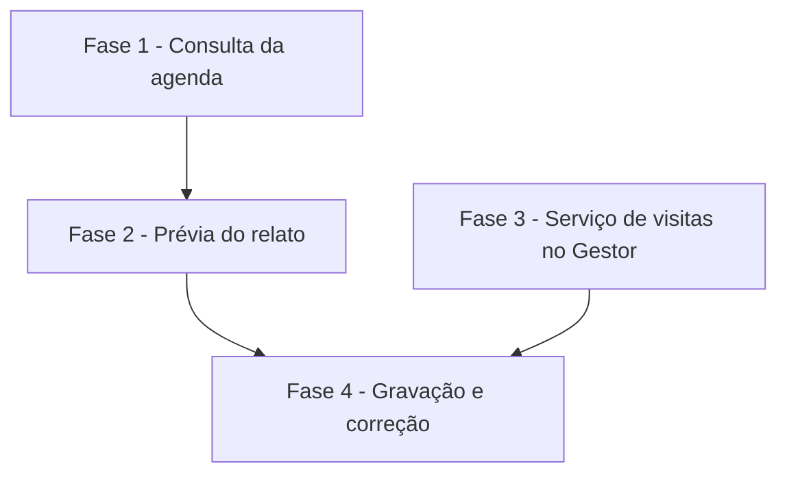

# Tarefas AlfaMatriz + Gestor - O Pedro lança e corrige o dia do técnico

Escopo: as 4 histórias de `spec.md` em três entregas publicáveis — consulta da agenda (FASE 1),
prévia do relato (FASE 2), gravação e correção no Gestor (FASES 3 e 4). Cada fase termina
publicável e utilizável sozinha.

**Legenda de status:**
- `[ ]` Pendente
- `[~]` Em andamento
- `[x]` Concluido
- `[!]` Bloqueado

**Legenda de criticidade:**
- `[C]` Critico - Impacto financeiro direto ou bloqueante
- `[A]` Alto - Funcionalidade essencial
- `[M]` Medio - Necessario mas sem urgencia imediata

---

## FASE 1 - Consulta da agenda (story 1)

### 1.1 Visitas no retrato do Gestor `[A]`

Ref: spec.md FR-002; research.md Decision 1; data-model.md "Visita no retrato"; contracts/runner-agenda.md §1

- [x] 1.1.1 Conferir no modelo `AtendimentoVisita` do Gestor as constantes de status e a tabela dos técnicos adicionais
- [x] 1.1.2 `suporte_gestor_ler.php`: lista `visitas` (janela −7/+14 dias, sem apagadas) e equipe com os técnicos das visitas
- [x] 1.1.3 Migração aditiva: coluna `visitas` no retrato (MariaDB e SQLite, com `down()`)
- [x] 1.1.4 `SuportePedroRunnerController::gestor` valida `visitas` item a item; `DiretorioGestor::gravar/retrato` guardam e devolvem
- [x] 1.1.5 Ensaio real: rodar o leitor na base local do Gestor e conferir a forma da lista contra o contrato
- [x] 1.1.6 Teste: retrato com visitas é gravado e lido; item inválido aponta o caminho do erro

### 1.2 Agenda no pedido interno `[A]`

Ref: spec.md FR-001, FR-002, FR-003; research.md Decisions 5 e 8

- [x] 1.2.1 `DiretorioGestor`: `visitasDoDia(tecnico, dia)` e `tecnicos(nome)` com grafia aproximada <!-- feito no AcessoInterno::agenda; a grafia aproximada do técnico fica com a IA, que recebe os nomes da equipe e a regra ("Victor" é o Vitor). Revisitar na FASE 2, onde o código confere o técnico. -->
- [x] 1.2.2 `AcessoInterno`: bloco `## AGENDA DOS TÉCNICOS` (dias citados no pedido, ou hoje e ontem), com cliente/pré-cliente, nº, horário, situação e hora da leitura
- [x] 1.2.3 `Contexto::promptInterno`: regra de consulta (responder só com o bloco; sem visita = "nada agendado")
- [x] 1.2.4 Teste: diretor pergunta o dia do Vitor e recebe a visita com o nome do pré-cliente (cenário 1)
- [x] 1.2.5 Teste: número fora da lista não recebe agenda (cenário 2); "Victor" acha "Vitor"
- [x] 1.2.6 Publicar (com autorização), instalar o leitor no runner e conferir uma consulta real

---

## FASE 2 - Prévia do relato (story 2)

### 2.1 Paradas propostas pela IA `[A]`

Ref: spec.md FR-004..FR-009, FR-016; research.md Decision 7

- [ ] 2.1.1 Regras do fluxo de relato no pedido interno (paradas, o que existe, conflitos, lacunas, insistir)
- [ ] 2.1.2 `Contexto::ler`: ação `agenda` com a lista de paradas (tipo, ids citados, técnico, início, fim, observação)
- [ ] 2.1.3 Teste: o bloco devolvido é lido e campos desconhecidos são descartados

### 2.2 Conferência e prévia `[A]`

Ref: spec.md FR-005..FR-008, FR-017; research.md Decisions 4, 5 e 7

- [ ] 2.2.1 `AgendaDoTecnico::conferir`: id inexistente, técnico fora da equipe, sem fim, fim antes do início, conflito com visita do dia
- [ ] 2.2.2 Prévia guardada na conversa (substitui a anterior), com bloqueios marcados
- [ ] 2.2.3 Papel: quem não é diretor/gestor recebe a consulta e a recusa da mudança
- [ ] 2.2.4 Teste: relato do Vitor de 23/10 gera a prévia com o conflito da Revizza e as lacunas (cenário 3)
- [ ] 2.2.5 Teste: suporte pedindo mudança não gera prévia gravável (cenário 6)
- [ ] 2.2.6 Publicar (com autorização) e conferir com um relato real do Wallas

---

## FASE 3 - Serviço de visitas no Gestor (pré-requisito da gravação)

### 3.1 Extrair reagendar e cancelar para serviço `[A]`

Ref: research.md Decision 3; Gestor CLAUDE.md regra 5

- [ ] 3.1.1 Ler `Api/V1/Admin/AtendimentoVisitaController` e mapear as regras de reagendar e cancelar
- [ ] 3.1.2 `AtendimentoVisitaService` (reagendar, cancelar) com as mesmas regras e mensagens
- [ ] 3.1.3 Controller da API passa a chamar o serviço, sem mudar o contrato do app
- [ ] 3.1.4 Testes de integração do serviço (reagendar, conflito, cancelar finalizada sem motivo)
- [ ] 3.1.5 Seção `App:` no commit; QA; publicar (com autorização)

---

## FASE 4 - Gravação e correção (stories 3 e 4)

### 4.1 Fila de mudanças no AlfaMatriz `[C]`

Ref: spec.md FR-010..FR-015; data-model.md "Mudança de agenda"; contracts/runner-agenda.md §2

- [ ] 4.1.1 Migração da tabela `suporte_gestor_agenda` e modelo
- [ ] 4.1.2 "Sim" converte a prévia em mudanças (e aberturas, para atendimento novo), com chave única
- [ ] 4.1.3 Rotas do runner: reservar e devolver resultado; mudança com abertura só depois dela feita
- [ ] 4.1.4 Resposta final a quem pediu, com números, falhas e o aviso de finalização às 23:55
- [ ] 4.1.5 Mudança que ninguém pegou vence como as aberturas
- [ ] 4.1.6 Testes: "sim" repetido não duplica; falha parcial; sem "sim" nada entra (cenários 4 e 5)

### 4.2 Aplicação no Gestor `[C]`

Ref: research.md Decisions 3 e 4; contracts/runner-agenda.md §3

- [ ] 4.2.1 `suporte_gestor_agenda.php`: criar visita (idempotente), reagendar e cancelar pelo serviço, conferindo o `esperado`
- [ ] 4.2.2 Ensaio sem `--apply` na base local do Gestor para cada tipo
- [ ] 4.2.3 Runner: volta da fila de agenda (com o vigia de gravação presa)
- [ ] 4.2.4 Teste de ponta a ponta na base local (cenário 7)
- [ ] 4.2.5 Publicar (com autorização), instalar no runner, reiniciar e observar uma gravação real

### 4.3 Correção pontual de visita (story 4) `[M]`

Ref: spec.md FR-013

- [ ] 4.3.1 Pedido "passa a visita X para …" vira prévia de uma mudança só, com antes e depois
- [ ] 4.3.2 Cancelamento pede o motivo
- [ ] 4.3.3 Testes da correção e do cancelamento

---

## Matriz de Dependencias

## Resumo Quantitativo

| Fase | Tarefas | Subtarefas | Criticidade |
|------|---------|------------|-------------|
| 1 - Consulta da agenda | 2 | 12 | A |
| 2 - Prévia do relato | 2 | 9 | A |
| 3 - Serviço de visitas no Gestor | 1 | 5 | A |
| 4 - Gravação e correção | 3 | 14 | C/M |
| **Total** | **8** | **40** | - |

## Escopo Coberto

- Consulta da agenda dos técnicos pelo WhatsApp (acesso interno).
- Relato livre (texto ou áudio) → prévia com o que existe, conflitos e lacunas.
- Gravação no Gestor só com o "sim" de diretor/gestor: visita nova, reagendar, cancelar, atendimento novo.
- Idempotência e reconferência do estado no Gestor.

## Escopo Excluido

- Jornada do técnico (almoço, hora extra): é do ponto do RH.
- Finalizar visita com horário real (decisão do dono: entra agendada; FR-015).
- Técnicos adicionais numa visita: a prévia avisa, não altera.
