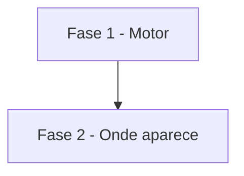

# Tarefas AlfaMatriz - Secretário, Etapa 7 (Acompanhamento Proativo)

Escopo: motor de regras sem IA, resumo com controle de excesso, tela, Telegram, chat, Meu Dia e briefing (spec
`secretario-acompanhamento`).

**Legenda de status:**
- `[ ]` Pendente
- `[~]` Em andamento
- `[x]` Concluido
- `[!]` Bloqueado

**Legenda de criticidade:**
- `[C]` Critico - Impacto financeiro direto ou bloqueante
- `[A]` Alto - Funcionalidade essencial
- `[M]` Medio - Necessario mas sem urgencia imediata

---

## FASE 1 - Motor

### 1.1 Banco e regras `[A]`

Ref: FR-001, FR-002, FR-003

- [x] 1.1.1 Migração (acompanhamentos, envios, preferência JSON) e models
- [x] 1.1.2 `Regras` (padrões, faixas, validação) e `Achados` das sete regras
- [x] 1.1.3 `Motor` (upsert por chave, resolução, regra desligada encerra)
- [x] 1.1.4 Teste: cada regra, duas rodadas sem duplicar, resolução, isolamento

### 1.2 Envio `[A]`

Ref: FR-004, FR-005, FR-006

- [x] 1.2.1 `Politica` (prioridade, silêncio, fim de semana, intervalo, teto, repetição)
- [x] 1.2.2 `Envio` (resumo agrupado, sino, Telegram com retentativa, registro)
- [x] 1.2.3 Comando `secretario:acompanhar` a cada 5 min
- [x] 1.2.4 Teste: alta imediata, normal no intervalo, baixa nunca, silêncio, teto, repetição, falha do Telegram

---

## FASE 2 - Onde aparece

### 2.1 Tela, Telegram, chat, Meu Dia e briefing `[M]`

Ref: FR-007 a FR-011

- [x] 2.1.1 Secretário → Acompanhamentos (lista, Resolvido, Adiar, histórico, regras) e menu
- [x] 2.1.2 Botão "Adiar estes até amanhã" no toque do Telegram
- [x] 2.1.3 "O que preciso acompanhar?" no `Conversa`
- [x] 2.1.4 Linha no Meu Dia e seção "🔔 Acompanhar" no briefing, sem repetição
- [x] 2.1.5 Teste: tela, validação, isolamento (404), toque único, chat, briefing

### 2.2 Verificação `[M]`

Ref: constitution V

- [x] 2.2.1 Suíte inteira e teste local no 8096 com os dados das Etapas 4 e 5
- [~] 2.2.2 Mostrar ao Felipe; publicar só com a liberação

---

## Matriz de Dependencias

## Resumo Quantitativo

| Fase | Tarefas | Subtarefas | Criticidade |
|------|---------|------------|-------------|
| 1 - Motor | 2 | 8 | A |
| 2 - Onde aparece | 2 | 7 | M |
| **Total** | **4** | **15** | - |

## Escopo Coberto

- Fase 8 da missão (8.1 e 8.2) e o item "Acompanhamentos" da Fase 10.1.

## Escopo Excluido

- WhatsApp, regras em linguagem livre, avisos a terceiros.
