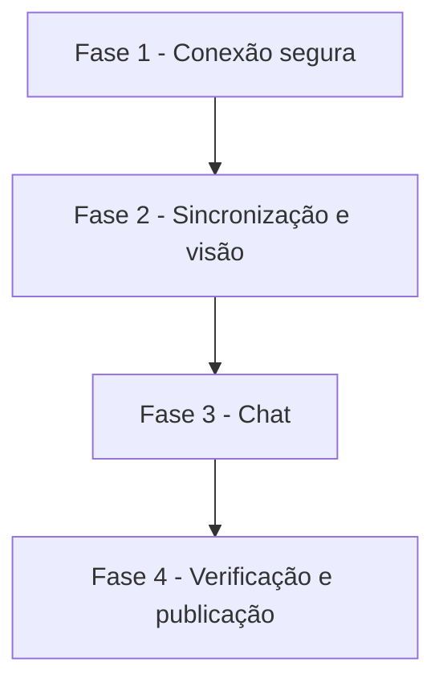

# Tarefas AlfaMatriz - Secretário, Etapa 2 (Agenda com Google)

Escopo: conexão Google (OAuth), sincronização, visão consolidada com conflitos e livres, perguntas de agenda sem
IA e criação de evento confirmada (spec `secretario-agenda`, FR-001 a FR-021).

**Legenda de status:**
- `[ ]` Pendente
- `[~]` Em andamento
- `[x]` Concluido
- `[!]` Bloqueado

**Legenda de criticidade:**
- `[C]` Critico - Impacto financeiro direto ou bloqueante
- `[A]` Alto - Funcionalidade essencial
- `[M]` Medio - Necessario mas sem urgencia imediata

---

## FASE 1 - Conexão segura

### 1.1 Dados e cliente Google `[C]`

Ref: data-model.md; FR-001–FR-004, FR-019–FR-021

- [x] 1.1.1 Migração com as 3 tabelas (tokens `encrypted` + `hidden`) e `down()`
- [x] 1.1.2 `GoogleAgenda`: URL de autorização, troca de código, renovação com trava, revogação, erros
  classificados sem token
- [x] 1.1.3 Chaves em `config/services.php` lidas do ambiente; sem elas, "não configurado"
- [x] 1.1.4 Teste: o token nunca aparece na resposta, no log nem no evento; renovação com trava; `invalid_grant`
  marca reconectar

### 1.2 Conectar e desconectar `[C]`

Ref: US1; FR-002, FR-004, FR-005, FR-008

- [x] 1.2.1 `SecretarioGoogleController`: conectar (`state` de uso único na sessão), retorno, desconectar
  (revoga e apaga), agendas
- [x] 1.2.2 Bloco Google nas Configurações: estado, agendas, padrão, palavras, "Sincronizar agora"
- [x] 1.2.3 Teste: `state` inválido ou de outra conta é recusado; desconectar apaga tudo; outra conta não mexe

---

## FASE 2 - Sincronização e visão

### 2.1 Sincronizador `[A]`

Ref: FR-006, FR-007, FR-018

- [x] 2.1.1 `SincronizadorGoogle`: agendas, eventos da janela (paginação), apagar os cancelados e os fora da janela
- [x] 2.1.2 `secretario:sincronizar-google` a cada 10 min
- [x] 2.1.3 Teste: dia inteiro, fuso diferente, cancelado, agenda desmarcada, aviso de reconectar uma vez

### 2.2 Agenda consolidada `[A]`

Ref: US2; FR-009–FR-011; SC-002

- [x] 2.2.1 `AgendaConsolidada::periodo` (3 fontes, origem, deduplicação)
- [x] 2.2.2 Conflitos e livres (08:00–18:00, 30 min ou mais)
- [x] 2.2.3 Tela Secretário → Agenda, com aviso de Google desatualizado
- [x] 2.2.4 Teste dos 10 casos do SC-002 e do isolamento

---

## FASE 3 - Chat

### 3.1 Perguntas de agenda `[A]`

Ref: US3; FR-012

- [x] 3.1.1 `ConsultaDeAgenda`: período e horário livre
- [x] 3.1.2 Interceptar no `Conversa` (web e Telegram), só com Google conectado
- [x] 3.1.3 Teste: resposta sem execução de IA; sem Google, o fluxo antigo segue

### 3.2 Criar evento no Google `[C]`

Ref: US4; FR-013–FR-016; SC-003

- [x] 3.2.1 Gatilho "agenda/marca" e duração no `Interpretador`
- [x] 3.2.2 Proposta `evento_google` (agenda por palavras, conflitos, sem convidados)
- [x] 3.2.3 Confirmação: cria uma vez, item do Secretário com aviso, "agendado" só depois do sucesso
- [x] 3.2.4 Teste: sucesso, falha do Google, confirmação repetida, sem convidados no envio

---

## FASE 4 - Verificação e publicação

### 4.1 Prova `[A]`

Ref: constitution V, VII

- [x] 4.1.1 Suíte inteira verde e migração em MariaDB
- [ ] 4.1.2 Commit na branch Felipe, tag e publicação; bot e scheduler conferidos
- [ ] 4.1.3 Pendente do Felipe: criar o cliente OAuth "Aplicativo da Web" e pôr id e segredo no `.env`;
  depois, conectar pela tela

---

## Matriz de Dependencias

## Resumo Quantitativo

| Fase | Tarefas | Subtarefas | Criticidade |
|------|---------|------------|-------------|
| 1 - Conexão segura | 2 | 7 | C |
| 2 - Sincronização e visão | 2 | 7 | A |
| 3 - Chat | 2 | 7 | C |
| 4 - Verificação e publicação | 1 | 3 | A |
| **Total** | **7** | **24** | - |

## Escopo Coberto

- OAuth, sincronização, visão consolidada, conflitos e livres, perguntas sem IA e criação confirmada de evento.

## Escopo Excluido

- Reagendar ou cancelar evento do Google pelo chat, convidados e agenda de terceiros: próxima rodada, com spec.
- Briefing (Etapa 3), reuniões por áudio (Etapa 4) e e-mail (Etapa 5).
