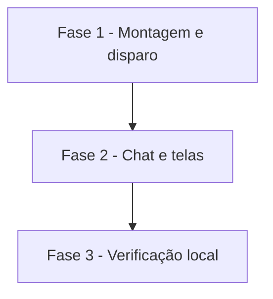

# Tarefas AlfaMatriz - Secretário, Etapa 3 (Briefing Executivo)

Escopo: briefing diário automático e sob demanda, com fontes honestas, entrega no Telegram e registro no Matriz
(spec `secretario-briefing`, FR-001 a FR-014). Publicação só depois do teste local.

**Legenda de status:**
- `[ ]` Pendente
- `[~]` Em andamento
- `[x]` Concluido
- `[!]` Bloqueado

**Legenda de criticidade:**
- `[C]` Critico - Impacto financeiro direto ou bloqueante
- `[A]` Alto - Funcionalidade essencial
- `[M]` Medio - Necessario mas sem urgencia imediata

---

## FASE 1 - Montagem e disparo

### 1.1 Dados e montador `[A]`

Ref: data-model.md; FR-004–FR-006, FR-009

- [x] 1.1.1 Migração (`secretario_briefings` e as colunas de preferência) com `down()`
- [x] 1.1.2 `MontadorDeBriefing`: seções, sugestão por regra, rodapé de fontes, limites
- [x] 1.1.3 Teste: seções, "+N", sem Google, dia vazio, sugestão e limite de tamanho

### 1.2 Disparo e entrega `[A]`

Ref: FR-001–FR-003, FR-007, FR-008, FR-014

- [x] 1.2.1 `Briefings::devidos/gerar/entregar` com chave única por dia e a regra do meio-dia
- [x] 1.2.2 `secretario:briefing` a cada minuto e sincronização prévia do Google
- [x] 1.2.3 Teste: horário, dias, repetição, parada, Telegram fora do ar e conta sem permissão

---

## FASE 2 - Chat e telas

### 2.1 Sob demanda e telas `[M]`

Ref: FR-010–FR-013

- [x] 2.1.1 "Resume meu dia" no `Conversa` (web e Telegram)
- [x] 2.1.2 Meu Dia com o briefing de hoje (recolhível) e as Configurações (ligado, hora, dias)
- [x] 2.1.3 Teste: pedido sem IA, sem perfil nada muda, isolamento e configurações

---

## FASE 3 - Verificação local

### 3.1 Prova local `[A]`

Ref: constitution V; pedido do Felipe ("somente após os testes locais")

- [x] 3.1.1 Suíte inteira verde e migração em MariaDB
- [x] 3.1.2 Ambiente local 8096: migrar, gerar o briefing pelo comando e ver o Meu Dia (captura de tela)
- [ ] 3.1.3 Mostrar ao Felipe e só publicar com a liberação dele

---

## Matriz de Dependencias

## Resumo Quantitativo

| Fase | Tarefas | Subtarefas | Criticidade |
|------|---------|------------|-------------|
| 1 - Montagem e disparo | 2 | 6 | A |
| 2 - Chat e telas | 1 | 3 | M |
| 3 - Verificação local | 1 | 3 | A |
| **Total** | **4** | **12** | - |

## Escopo Coberto

- Briefing automático e sob demanda, fontes honestas, Telegram, Meu Dia e configurações.

## Escopo Excluido

- E-mail, reuniões, Gestor e WhatsApp no briefing (entram com as etapas deles); sugestão escrita por IA.
