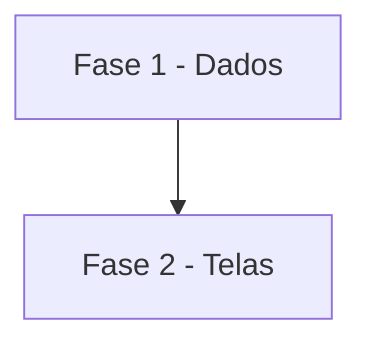

# Tarefas AlfaMatriz - Secretário, Etapa 8 (Central do dia e de gestão)

Escopo: Meu Dia "Lá fora", Central de gestão, regras em Configurações, agenda em calendário, caixas do Gestor e não
lidos (spec `secretario-central-do-dia`).

**Legenda de status:**
- `[ ]` Pendente
- `[~]` Em andamento
- `[x]` Concluido
- `[!]` Bloqueado

**Legenda de criticidade:**
- `[C]` Critico - Impacto financeiro direto ou bloqueante
- `[A]` Alto - Funcionalidade essencial
- `[M]` Medio - Necessario mas sem urgencia imediata

---

## FASE 1 - Dados

### 1.1 Lá fora e e-mail `[A]`

Ref: FR-001, FR-002, FR-007, FR-008

- [x] 1.1.1 `LaFora` e o comando `secretario:la-fora`
- [x] 1.1.2 Migração (`empresa`, `lido`) e FLAGS no IMAP
- [!] 1.1.3 Cópia das caixas do Gestor (ponte e importação) — bloqueada: Gestor fora do ar em 17/10 ~16:30
- [x] 1.1.4 Testes: fontes, idade, texto puro, flags sem STORE, importação

---

## FASE 2 - Telas

### 2.1 Meu Dia, Central, Configurações, Agenda e menu `[A]`

Ref: FR-003 a FR-006, FR-009, FR-010

- [x] 2.1.1 Bloco "Lá fora" no Meu Dia
- [x] 2.1.2 Central de gestão em Acompanhamentos (números, Grupo Soluções, VixCard, lançar ponto)
- [x] 2.1.3 Regras em Configurações
- [x] 2.1.4 Minha agenda em calendário
- [x] 2.1.5 Memória fora do menu
- [~] 2.1.6 Testes de tela e isolamento; suíte; teste local; publicação

---

## Matriz de Dependencias

## Resumo Quantitativo

| Fase | Tarefas | Subtarefas | Criticidade |
|------|---------|------------|-------------|
| 1 - Dados | 1 | 4 | A |
| 2 - Telas | 1 | 6 | A |
| **Total** | **2** | **10** | - |

## Escopo Coberto

- Pedido do Felipe de 17/10/2026 depois da v2026.10.17.5.

## Escopo Excluido

- Placar e próximo jogo do Flamengo, sistema da VixCard, WhatsApp.
