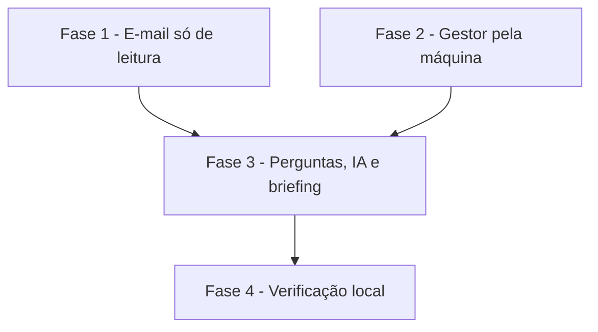

# Tarefas AlfaMatriz - Secretário, Etapa 5 (e-mails e Gestor)

Escopo: caixas IMAP só de leitura, classificação, perguntas sem IA, resumo e rascunho pela IA, retrato do Gestor
pela ponte, "o que estou devendo" e as seções no briefing (spec `secretario-emails-gestor`).

**Legenda de status:**
- `[ ]` Pendente
- `[~]` Em andamento
- `[x]` Concluido
- `[!]` Bloqueado

**Legenda de criticidade:**
- `[C]` Critico - Impacto financeiro direto ou bloqueante
- `[A]` Alto - Funcionalidade essencial
- `[M]` Medio - Necessario mas sem urgencia imediata

---

## FASE 1 - E-mail só de leitura

### 1.1 Cliente IMAP e caixas `[C]`

Ref: research D1; FR-001–FR-003, FR-017

- [x] 1.1.1 `ClienteImap` (TLS, LOGIN, LIST, EXAMINE, UID SEARCH, UID FETCH BODY.PEEK, LOGOUT; literais; decodificação de cabeçalho)
- [x] 1.1.2 Migração e modelos (senha `encrypted` e hidden)
- [x] 1.1.3 Configurações: cadastrar, testar e remover caixa (só SSL/TLS)
- [x] 1.1.4 Teste: transporte simulado, só comandos de leitura, senha fora de tela, log e resposta

### 1.2 Leitura e classificação `[A]`

Ref: FR-004–FR-007; research D3

- [x] 1.2.1 `LeitorDeEmails`: 3 dias na primeira vez, depois os novos; UIDVALIDITY; enviados → respondido
- [x] 1.2.2 `Classificador` (tipo, urgência, pede retorno) e a limpeza dos 30 dias
- [x] 1.2.3 `secretario:emails` a cada 10 min; erro por caixa sem parar as outras
- [x] 1.2.4 Teste: classificação, respondido, duplicata, falha, isolamento

---

## FASE 2 - Gestor pela máquina

### 2.1 Retrato `[A]`

Ref: research D4; contracts/gestor-retrato.md; FR-011–FR-013

- [x] 2.1.1 `secretario_gestor.php` (consultas do resumo do Gestor, linha `SECRETARIO_GESTOR:`)
- [x] 2.1.2 `gestor.mjs` e o laço do runner (de hora em hora e às 06:30–07:00)
- [x] 2.1.3 Rota `runner/gestor` com validação e o último retrato por conta
- [x] 2.1.4 Teste: retrato válido, inválido (mantém o anterior), velho, isolamento; teste Node do parser

---

## FASE 3 - Perguntas, IA e briefing

### 3.1 Perguntas e telas `[A]`

Ref: FR-008–FR-010, FR-014, FR-015

- [x] 3.1.1 `ConsultaDeEmails` e `ConsultaDePendencias` no `Conversa`
- [x] 3.1.2 `PedidoDeEmailIa` (resumo e rascunho como dado não confiável), tela Mensagens, "Lembrar de responder"
- [x] 3.1.3 Briefing com "Mensagens importantes" e "Pendências do Gestor"
- [x] 3.1.4 Teste: perguntas sem IA, instrução maliciosa no e-mail, briefing com e sem fontes

---

## FASE 4 - Verificação local

### 4.1 Prova local `[A]`

Ref: constitution V; pedido do Felipe

- [x] 4.1.1 Suíte inteira e migração em MariaDB
- [x] 4.1.2 GreenMail local: cadastrar, ler, classificar, conferir `\Seen` intacto; ponte do Gestor em DRY
- [ ] 4.1.3 Mostrar ao Felipe; publicar só com a liberação

---

## Matriz de Dependencias

## Resumo Quantitativo

| Fase | Tarefas | Subtarefas | Criticidade |
|------|---------|------------|-------------|
| 1 - E-mail só de leitura | 2 | 8 | C |
| 2 - Gestor pela máquina | 1 | 4 | A |
| 3 - Perguntas, IA e briefing | 1 | 4 | A |
| 4 - Verificação local | 1 | 3 | A |
| **Total** | **5** | **19** | - |

## Escopo Coberto

- Caixas IMAP só de leitura, classificação, perguntas, resumo e rascunho, retrato do Gestor, pendências e briefing.

## Escopo Excluido

- Envio de e-mail, OAuth de Gmail/Outlook, anexos, escrita no Gestor, WhatsApp.
