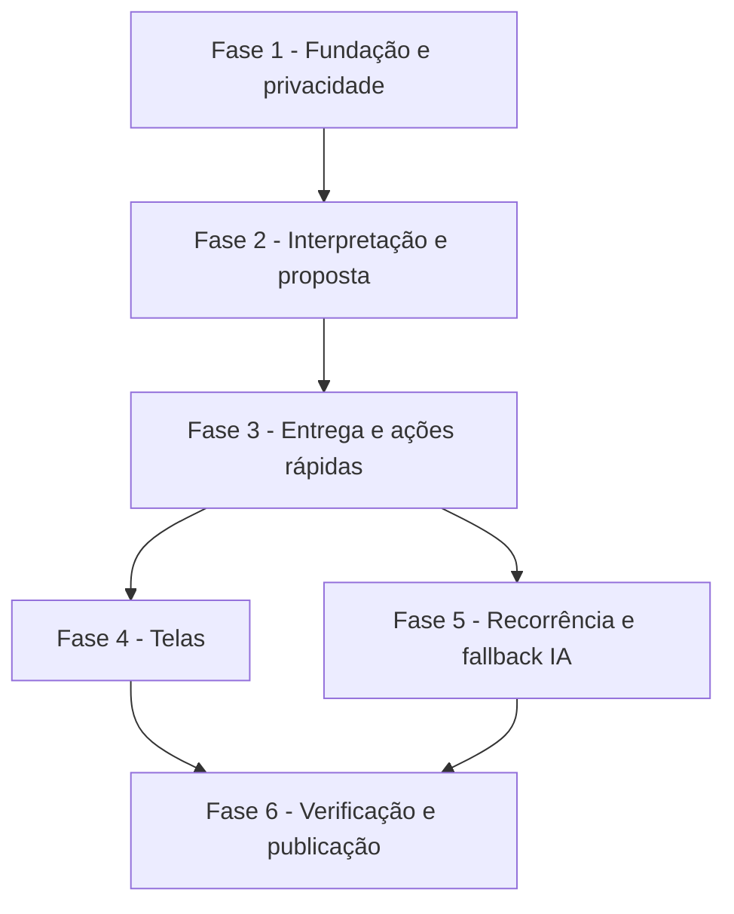

# Tarefas AlfaMatriz - Secretário Executivo, Etapa 1 (núcleo)

Escopo: itens pessoais, interpretação com confirmação, despacho de lembretes no sino e no Telegram com botões,
recorrência, Meu Dia e configurações, só para a conta dona (spec `secretario-executivo`, FR-001 a FR-028).

**Legenda de status:**
- `[ ]` Pendente
- `[~]` Em andamento
- `[x]` Concluido
- `[!]` Bloqueado

**Legenda de criticidade:**
- `[C]` Critico - Impacto financeiro direto ou bloqueante
- `[A]` Alto - Funcionalidade essencial
- `[M]` Medio - Necessario mas sem urgencia imediata

---

## FASE 1 - Fundação e privacidade

### 1.1 Migração, modelos e permissão `[C]`

Ref: data-model.md; FR-001, FR-002, FR-003, FR-028; research D1, D2

- [x] 1.1.1 Migração `2026_10_17_100000_criar_secretario.php`: as tabelas `secretario_itens`, `_avisos`,
  `_propostas`, `_preferencias` e `_toques`, mais o recurso e o perfil `secretario`, com `down()`
- [x] 1.1.2 Modelos `SecretarioItem`, `SecretarioAviso`, `SecretarioProposta`, `SecretarioPreferencia` e
  `SecretarioToque`, com `scopeDe(User)` e casts
- [x] 1.1.3 `PerfilPermissaoSeeder`: excluir `secretario` do administrador
- [x] 1.1.4 Teste: migrar e reverter no SQLite; o admin não recebe `secretario`

### 1.2 Rotas, menu e isolamento `[C]`

Ref: contracts/rotas-web.md; FR-002, FR-004, FR-021; SC-005

- [x] 1.2.1 `SecretarioController` com as rotas do contrato em `routes/web.php` (`permissao:secretario`)
- [x] 1.2.2 Grupo "Secretário" → "Meu Dia" na `navigation.blade.php` (ícone `sun`, `recurso => secretario`)
- [x] 1.2.3 Teste de isolamento:
  - a conta B (admin) recebe 404 em item, proposta e ação da conta A;
  - sem o perfil, 403 e menu oculto;
  - itens não aparecem em `AgendaService::itens` nem em `ver_agenda` (MCP)

---

## FASE 2 - Interpretação e proposta (US1)

### 2.1 Interpretador determinístico `[A]`

Ref: research D7; FR-006, FR-009; SC-001

- [x] 2.1.1 `Services/Secretario/Interpretador`, com relógio injetado: gatilhos, "quando", "o quê" e tipo
- [x] 2.1.2 Regras de ambiguidade: hora sem período, amanhã depois da meia-noite, dia da semana igual a hoje,
  hora no passado, só data às 08:00
- [x] 2.1.3 Saída: proposta, `falta=quando` ou `nao_e_do_secretario`
- [x] 2.1.4 Teste unitário com as 20 frases do SC-001 (pelo menos 18 certas, nenhuma data inventada) e as
  bordas 23:30/00:30

### 2.2 Propostas e confirmação `[A]`

Ref: research D8; FR-008, FR-009, FR-011

- [x] 2.2.1 `Services/Secretario/Propostas`: criar, confirmar (idempotente, com trava), descartar, corrigir
  ("não, às 10h") e expirar em 30 min
- [x] 2.2.2 Resumo por extenso da proposta ("sáb, 17/10 às 09:00"), em pt-BR
- [x] 2.2.3 Rotas `interpretar`, `propostas/{id}/confirmar` e `descartar`
- [x] 2.2.4 Teste:
  - confirmar duas vezes cria um item só;
  - a correção substitui a proposta;
  - proposta de outra conta dá 404;
  - texto com "apague todos" não altera nada

### 2.3 Secretário na conversa da Central `[A]`

Ref: research D10, D11; FR-010; contracts/telegram.md

- [x] 2.3.1 `ConversaService::registrarDoAgente(..., entregar: true)`, parâmetro aditivo
- [x] 2.3.2 `Services/Secretario/Conversa`: frase nova, sim/não/correção da proposta pendente, registro no
  histórico quando o canal permite
- [x] 2.3.3 `CentralIaController::enviar`: interceptar depois do código de 6 dígitos, só com
  `secretario,incluir`
- [x] 2.3.4 `TelegramCanal::receberNoBot`: interceptar depois de encaminhada e do código, antes do canal ativo;
  responder a proposta com o teclado Confirmar/Corrigir
- [x] 2.3.5 Teste:
  - pedido de código ("analise o controller") segue para a Central sem mudança;
  - sem perfil, nada muda;
  - com o canal no web, o Telegram atende sem tirar a conversa da tela;
  - a suíte `tests/Feature/CentralIa` continua verde

---

## FASE 3 - Entrega e ações rápidas (US2)

### 3.1 Despachante `[C]`

Ref: research D3–D6; FR-012–FR-015, FR-025–FR-027; SC-002

- [x] 3.1.1 `Despachante::programar(item)`: avisos por canal (sino sempre; Telegram se pareado e ligado) e
  cancelamento dos avisos pendentes ao reprogramar
- [x] 3.1.2 `Despachante::despachar()`:
  - reserva com trava e `enviando` antes da chamada;
  - sino na mesma transação;
  - Telegram fora da transação, com teclado;
  - `atrasado` acima de 2 min
- [x] 3.1.3 Tentativas de 1, 2, 4, 8 e 15 min até `para + 30 min`; `recusada` vira falhou; preso em
  `enviando` vira incerta
- [x] 3.1.4 Comando `secretario:despachar` agendado a cada minuto (`withoutOverlapping`, `onOneServer`)
- [x] 3.1.5 Teste:
  - 50 horários entregues uma vez cada;
  - execução repetida no mesmo minuto;
  - item concluído antes da hora não é avisado;
  - parada de 5 min entrega como atrasado;
  - falha 500 → tentativas → falhou;
  - texto do item fora do log

### 3.2 Ações rápidas `[A]`

Ref: FR-016, FR-017, FR-020

- [x] 3.2.1 `Services/Secretario/Itens`: concluir, adiar 15, adiar 60, amanhã, reagendar, cancelar (só esta /
  todas), com trava e idempotência
- [x] 3.2.2 Rotas `itens/{id}/acao` e `reagendar`; item encerrado responde 409
- [x] 3.2.3 Eventos (`Eventos::registrar`) sem título
- [x] 3.2.4 Teste de cada ação, de item encerrado e de concorrência entre concluir e despachar

### 3.3 Botões no Telegram `[C]`

Ref: contracts/telegram.md; FR-016–FR-018; research D10

- [x] 3.3.1 `allowed_updates` com `callback_query` em `CentralIaTelegram`
- [x] 3.3.2 `TelegramDoSecretario::toque`: as 7 regras de segurança na ordem do contrato,
  `answerCallbackQuery` sempre, `editMessageText` com o resultado
- [x] 3.3.3 Encaminhar o `callback_query` em `TelegramCanal::receber`
- [x] 3.3.4 Teste:
  - toque de chat não pareado é recusado;
  - toque repetido não faz nada;
  - toque em aviso de outra conta é recusado;
  - ação inválida no `data` é recusada;
  - cada ação válida funciona

---

## FASE 4 - Telas (US3, US5)

### 4.1 Meu Dia `[A]`

Ref: FR-022, FR-023; quickstart cenário 6

- [x] 4.1.1 `GET /secretario/itens`: atrasados, hoje, próximos, sem data e próximo, com `quando_texto`
- [x] 4.1.2 `secretario/meu-dia.blade.php`:
  - saudação;
  - campo Registrar com proposta inline;
  - seções;
  - ações em um toque, sem recarregar;
  - mobile first
- [x] 4.1.3 Aviso de "Telegram não pareado" e estado vazio "nada registrado para hoje"
- [x] 4.1.4 Teste: as seções e a ordem, a roundtrip de interpretar → confirmar → itens, e o padrão do redesign
  (sem hex, sem `<table>`)

### 4.2 Configurações `[M]`

Ref: FR-024; US5

- [x] 4.2.1 `secretario/configuracoes.blade.php` e `PUT`, com validação
- [x] 4.2.2 Confirmação automática só para proposta inequívoca (research D8)
- [x] 4.2.3 Teste: os padrões sem linha gravada, a confirmação automática e a antecedência aplicada ao
  compromisso

---

## FASE 5 - Recorrência e fallback com IA (US4, US1 cenário 7)

### 5.1 Recorrência `[M]`

Ref: FR-019, FR-020; US4

- [x] 5.1.1 `Services/Secretario/Recorrencia`: diária, semanal (vários dias) e mensal (último dia quando faltar)
- [x] 5.1.2 Avançar a ocorrência ao concluir, adiar ou cancelar "só esta", e reprogramar os avisos
- [x] 5.1.3 Teste unitário (31 em fevereiro, segunda que vira próxima segunda) e de dois dias de relógio

### 5.2 Proposta pela IA `[M]`

Ref: research D9; FR-007

- [x] 5.2.1 `PropostaDaIa`: pedir à Central (projeto `''`, `analisar`, `roteamento.secretario`) quando o
  runner está online
- [x] 5.2.2 `AgentesService::concluir`: extrair `<<<SECRETARIO … SECRETARIO>>>`, validar e criar a proposta
  pendente, sempre com confirmação manual
- [x] 5.2.3 Runner offline: resposta "Não entendi quando…"
- [x] 5.2.4 Teste: bloco válido, bloco com data passada ou campo estranho (recusado) e runner offline

---

## FASE 6 - Verificação e publicação

### 6.1 Suíte e limpeza `[A]`

Ref: constitution V

- [x] 6.1.1 `central-ia:limpar` apaga toques com mais de 7 dias e propostas encerradas com mais de 30 dias
- [x] 6.1.2 A suíte inteira verde (lab isolado)
- [x] 6.1.3 Migração conferida em MariaDB (subir, descer, subir) numa cópia local

### 6.2 Publicação e prova real `[A]`

Ref: quickstart cenários 1–5; constitution VII

- [ ] 6.2.1 Commit na branch Felipe e tag de produção, só com autorização do Felipe
- [ ] 6.2.2 Depois do deploy: conferir que o bot reiniciou e lê `callback_query`
- [ ] 6.2.3 O Felipe liga o perfil "Secretário" na própria conta (tela de usuários)
- [ ] 6.2.4 Critério de aceite 1 real ("me lembra daqui a 10 minutos…") e o cenário 7 (persistência após
  reinício)

---

## Matriz de Dependencias

## Resumo Quantitativo

| Fase | Tarefas | Subtarefas | Criticidade |
|------|---------|------------|-------------|
| 1 - Fundação e privacidade | 2 | 7 | C |
| 2 - Interpretação e proposta | 3 | 13 | A |
| 3 - Entrega e ações rápidas | 3 | 13 | C |
| 4 - Telas | 2 | 7 | A |
| 5 - Recorrência e fallback IA | 2 | 7 | M |
| 6 - Verificação e publicação | 2 | 7 | A |
| **Total** | **14** | **54** | - |

## Escopo Coberto

- Itens pessoais, interpretação, confirmação, despacho, botões, ações rápidas, recorrência, Meu Dia,
  configurações e fallback com IA.
- Isolamento por conta, rastro sem conteúdo e prova real em produção.

## Escopo Excluido

- Agenda consolidada e Google OAuth (Etapa 2), briefing (Etapa 3), voz e Meetings (Etapa 4), e-mail e Gestor
  (Etapa 5), memória (Etapa 6), acompanhamento proativo e horário de silêncio (Etapa 7), WhatsApp (Etapa 8).
  Cada uma terá a própria spec.
- Notificação por e-mail: o AlfaMatriz não tem envio de e-mail configurado (`MAIL_MAILER=log`).
