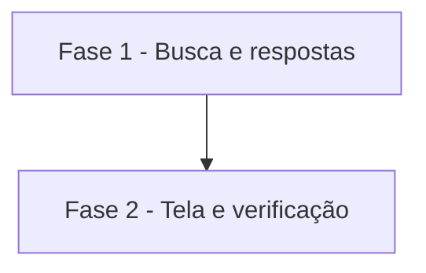

# Tarefas AlfaMatriz - Secretário, Etapa 6 (Memória Executiva)

Escopo: perguntas sobre o histórico com fonte, data e link; busca; síntese opcional (spec `secretario-memoria`).

**Legenda de status:**
- `[ ]` Pendente
- `[~]` Em andamento
- `[x]` Concluido
- `[!]` Bloqueado

**Legenda de criticidade:**
- `[C]` Critico - Impacto financeiro direto ou bloqueante
- `[A]` Alto - Funcionalidade essencial
- `[M]` Medio - Necessario mas sem urgencia imediata

---

## FASE 1 - Busca e respostas

### 1.1 Busca nas fontes `[A]`

Ref: FR-002, FR-003, FR-005, FR-009

- [x] 1.1.1 `BuscaNaMemoria` (cinco fontes, termos normalizados, pontuação, links)
- [x] 1.1.2 Natureza de cada resultado (fato, extraído, inferência)
- [x] 1.1.3 Teste: acentos, isolamento, corte por fonte

### 1.2 Perguntas `[A]`

Ref: FR-001, FR-004, FR-006–FR-008

- [x] 1.2.1 `ConsultaDeMemoria`: decidido, combinado ou pendente, reuniões do período, compromissos, propostas, busca
- [x] 1.2.2 Ligação ao `Conversa` e a síntese pela IA (opcional)
- [x] 1.2.3 Teste: critério 5, períodos, sem resultado, síntese só com trechos

---

## FASE 2 - Tela e verificação

### 2.1 Tela e prova local `[M]`

Ref: US4; constitution V

- [x] 2.1.1 Secretário → Memória (busca com resultados por fonte)
- [x] 2.1.2 Suíte inteira e teste local com os dados das Etapas 4 e 5
- [~] 2.1.3 Mostrar ao Felipe; publicar só com a liberação

---

## Matriz de Dependencias

## Resumo Quantitativo

| Fase | Tarefas | Subtarefas | Criticidade |
|------|---------|------------|-------------|
| 1 - Busca e respostas | 2 | 6 | A |
| 2 - Tela e verificação | 1 | 3 | M |
| **Total** | **3** | **9** | - |

## Escopo Coberto

- Perguntas da missão sobre o histórico, busca com fonte e link, síntese opcional.

## Escopo Excluido

- Busca semântica por vetores e histórico de outras pessoas.
