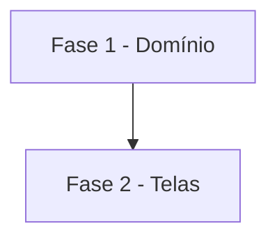

# Tarefas AlfaMatriz - Notificações tratadas uma a uma em Acompanhamentos

Escopo: a lista inteira das notificações em Acompanhamentos, o sino levando para lá e o Abrir indo ao lugar certo
(spec `secretario-notificacoes-em-acompanhamentos`).

**Legenda de status:**
- `[ ]` Pendente
- `[~]` Em andamento
- `[x]` Concluido
- `[!]` Bloqueado

**Legenda de criticidade:**
- `[C]` Critico - Impacto financeiro direto ou bloqueante
- `[A]` Alto - Funcionalidade essencial
- `[M]` Medio - Necessario mas sem urgencia imediata

---

## FASE 1 - Domínio

### 1.1 Destino e gravidade do aviso `[A]`

Ref: FR-005, FR-006

- [x] 1.1.1 `Notificacao::tom()` e `Notificacao::destino()`
- [x] 1.1.2 `abrir` pelo destino; rota `notificacoes.nao-lida`

---

## FASE 2 - Telas

### 2.1 Acompanhamentos e sino `[A]`

Ref: FR-001 a FR-004, FR-006

- [x] 2.1.1 Seção "Notificações" em Acompanhamentos (abas, busca, Abrir, Tratado, Desfazer, Tratadas)
- [x] 2.1.2 Sino: linha e rodapé levando a Acompanhamentos para quem a tem
- [x] 2.1.3 Testes: lista, isolamento, destaque, destino, desfazer, sino da revenda
- [~] 2.1.4 Suíte; teste local na 8096; publicação (depende do Felipe)

---

## Matriz de Dependencias

## Resumo Quantitativo

| Fase | Tarefas | Subtarefas | Criticidade |
|------|---------|------------|-------------|
| 1 - Domínio | 1 | 2 | A |
| 2 - Telas | 1 | 4 | A |
| **Total** | **2** | **6** | - |

## Escopo Coberto

- Pedido do Felipe de 07/11/2026 (captura do sino com 114 não lidas).

## Escopo Excluido

- Agrupar por assunto, tratar em lote e mudar quem recebe cada aviso.
