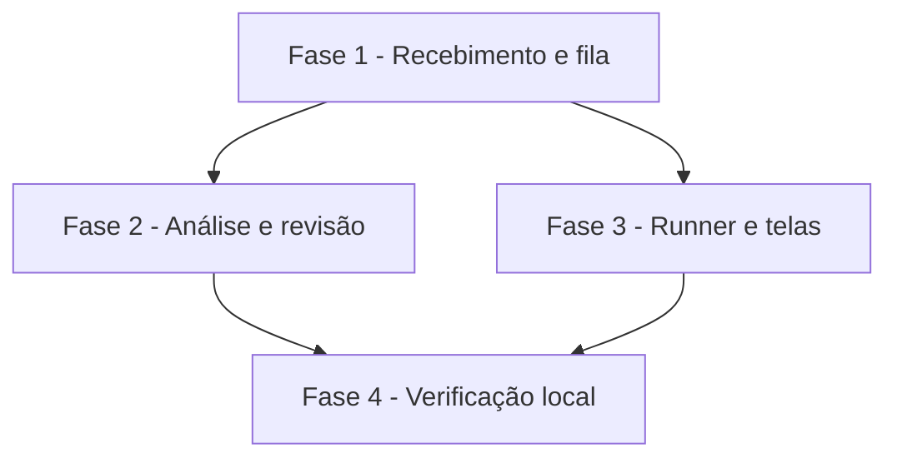

# Tarefas AlfaMatriz - Secretário, Etapa 4 (Matriz Meetings)

Escopo: áudio de reunião transcrito na máquina, analisado pela IA da pessoa, revisado e transformado em itens
(spec `secretario-reunioes`, FR-001 a FR-014). Publicação só depois do teste local.

**Legenda de status:**
- `[ ]` Pendente
- `[~]` Em andamento
- `[x]` Concluido
- `[!]` Bloqueado

**Legenda de criticidade:**
- `[C]` Critico - Impacto financeiro direto ou bloqueante
- `[A]` Alto - Funcionalidade essencial
- `[M]` Medio - Necessario mas sem urgencia imediata

---

## FASE 1 - Recebimento e fila

### 1.1 Dados e recebimento `[C]`

Ref: data-model.md; FR-001–FR-003, FR-013

- [x] 1.1.1 Migração e modelos (reunião, trechos, propostas)
- [x] 1.1.2 `Reunioes::receber` (tipo real, 12 MB, disco privado, sha256, deduplicação do Telegram)
- [x] 1.1.3 Upload pela tela e voz/áudio pelo Telegram (ditado até 60 s)
- [x] 1.1.4 Teste: tipos aceitos e recusados, isolamento, reenvio do Telegram

### 1.2 Fila do runner `[C]`

Ref: contracts/runner-transcricao.md; FR-002–FR-004, FR-014

- [x] 1.2.1 Rotas `transcricoes/proxima`, `audio` e resultado, com reserva travada e só da própria conta
- [x] 1.2.2 Resultado: grava os trechos, apaga o áudio, encaminha o ditado ou pede a análise
- [x] 1.2.3 `secretario:reunioes`: libera as presas e falha depois de 3 tentativas (apagando o áudio)
- [x] 1.2.4 Teste: reserva única, outra máquina ou conta, áudio apagado, presa liberada

---

## FASE 2 - Análise e revisão

### 2.1 Análise pela IA `[A]`

Ref: research D3, D4; FR-005–FR-007, FR-009

- [x] 2.1.1 `AnaliseDeReuniao::pedir` (instrução com trechos numerados, dado não confiável, corte de 60 KB)
- [x] 2.1.2 Gancho no `AgentesService::concluir`: validar, gravar, avisar no sino e no Telegram
- [x] 2.1.3 Teste: bloco válido, evidência inexistente, tipo fora da lista, instrução maliciosa, parcial

### 2.2 Revisão `[A]`

Ref: FR-008

- [x] 2.2.1 Aprovar, aprovar em lote (sem hipótese nem sugestão), descartar e editar
- [x] 2.2.2 Item do Secretário com origem na reunião e lembrete quando há prazo
- [x] 2.2.3 Teste: uma vez por tarefa, lote, edição, isolamento

---

## FASE 3 - Runner e telas

### 3.1 Transcrição no runner `[A]`

Ref: research D1; FR-004

- [x] 3.1.1 Imagem `whisper` (Dockerfile, script com trechos)
- [x] 3.1.2 `transcricao.mjs` e o laço do `runner.mjs`; `instalar.sh` constrói a imagem
- [x] 3.1.3 Teste Node com áudio em português sintetizado

### 3.2 Telas `[M]`

Ref: FR-011, FR-012

- [x] 3.2.1 Reuniões: lista, pesquisa, upload, gravação (aviso LGPD)
- [x] 3.2.2 Detalhe com evidências e revisão; ata para impressão; item no menu
- [x] 3.2.3 Teste: telas, pesquisa e ata

---

## FASE 4 - Verificação local

### 4.1 Prova local `[A]`

Ref: constitution V; pedido do Felipe

- [x] 4.1.1 Suíte inteira e migração em MariaDB
- [x] 4.1.2 Local 8096 com o runner real: áudio de reunião sintetizado → transcrição → análise → aprovação
- [ ] 4.1.3 Mostrar ao Felipe; publicar só com a liberação

---

## Matriz de Dependencias

## Resumo Quantitativo

| Fase | Tarefas | Subtarefas | Criticidade |
|------|---------|------------|-------------|
| 1 - Recebimento e fila | 2 | 8 | C |
| 2 - Análise e revisão | 2 | 6 | A |
| 3 - Runner e telas | 2 | 6 | A |
| 4 - Verificação local | 1 | 3 | A |
| **Total** | **7** | **23** | - |

## Escopo Coberto

- Entrada (Telegram, upload, gravação), transcrição local, análise validada, revisão, ditado, telas, pesquisa e ata.

## Escopo Excluido

- Diarização (quem fala), áudio acima de 12 MB, reuniões ligadas a e-mail ou Gestor: etapas seguintes.
